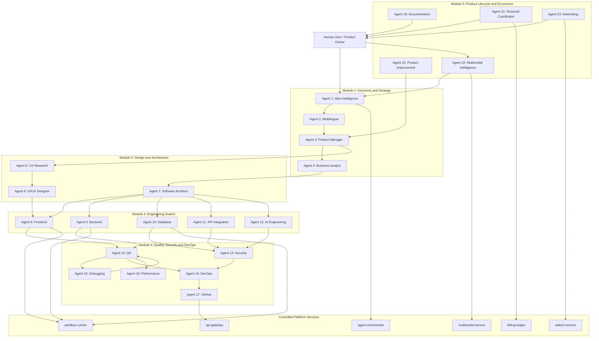

# Worklexx AI Software Factory — 23-Agent Ecosystem Specification

## Document Metadata

- **Document ID:** WLX-ARCH-005
- **Status:** Revised Architecture Blueprint — Phase 0 Revision Cycle; Awaiting Final Human Review and Approval
- **Author:** Lead Enterprise Software Architect, Principal AI Systems Engineer
- **Target Repository:** `https://github.com/samuel1599361/worklexx-ai-software-factory`
- **Classification:** Enterprise Technical Specification
- **Revision Scope:** Agent responsibilities, logical module organization, service ownership, permissions, workflow orchestration, financial authority, security boundaries, human approvals, and acceptance criteria.

---

## 1. Purpose and Architectural Philosophy

The Worklexx AI Software Factory is designed around an ecosystem of **23 specialized AI agents**. Each agent has a defined responsibility, restricted authority, typed inputs and outputs, and explicit interaction boundaries.

The agents collectively support the software production lifecycle, from initial idea discovery through product definition, design, engineering, testing, security, deployment preparation, documentation, and continuous improvement.

The ecosystem is designed as a controlled agentic assembly line rather than an unrestricted collection of autonomous agents.

### 1.1 The 23 agents are not 23 microservices

The 23 agents are logical software components. They are not independent deployable microservices.

They are organized into five logical modules and executed through the Agent Orchestrator and its controlled worker runtime, using durable workflow coordination where approved.

The platform has six defined backend deployables:

1. `api-gateway`
2. `agent-orchestrator`
3. `multimodal-service`
4. `sandbox-runner`
5. `billing-ledger`
6. `adtech-service`

Agent capabilities must be mapped to these deployables. An additional AI Gateway, model router, agent runtime, or other capability must not silently become a seventh deployable service.

The AI model-routing capability is a logical capability assigned to the approved architecture, not an independently assumed service.

### 1.2 Five logical agent modules

| Module | Agents | Primary responsibility |
|---|---:|---|
| Discovery and Strategy | 1–4 | Understand ideas, language, product requirements, and business rules |
| Design and Architecture | 5–7 | Research user needs, design interfaces, and define technical architecture |
| Engineering Swarm | 8–12 | Build frontend, backend, database, integrations, and application AI capabilities |
| Quality, Security and DevOps | 13–17, 19 | Validate, secure, debug, prepare delivery, manage authorized GitHub operations, and assess performance |
| Product Lifecycle and Economics | 18, 20–23 | Documentation, product improvement, financial coordination, multimodal processing, and advertising |

Agent numbering is an identity convention, not a required execution sequence. Workflow dependencies determine the actual execution order.

### 1.3 Logical ecosystem diagram



The diagram is conceptual. It does not imply that every agent directly communicates with every other agent, that agents bypass the orchestrator, or that the illustrated connections represent implemented APIs.

### 1.4 Separation of cognitive agents from deterministic services

AI agents perform bounded cognitive tasks, including:

- Reasoning and analysis.
- Requirement interpretation.
- Code and test generation.
- Documentation synthesis.
- Classification and recommendation.
- Workflow planning and coordination.

Deterministic services enforce:

- Authentication and authorization.
- Tenant and project isolation.
- Financial calculations and ledger postings.
- Payment signature verification.
- Credit reservation and settlement.
- Approval validity.
- Workflow state transitions.
- Sandbox isolation.
- Audit and authoritative records.

**No AI agent may independently authorize a financial transaction, mutate authoritative financial balances, verify a payment as genuine, override deterministic policy, or approve its own consequential action.**

---

## 2. Agent Identity and Specification Convention

Each agent must have:

- A stable identifier (`agent_id`).
- A defined name and purpose.
- A versioned responsibility specification.
- Explicit inputs and outputs.
- A restricted tool and action allowlist.
- Tenant, project, and artifact scope.
- Resource and execution limits.
- Defined upstream and downstream dependencies.
- Error and escalation procedures.
- Applicable human approval requirements.
- Versioned evaluation and acceptance criteria.

Model selection must use a capability-based, versioned model catalogue. Specific model names in examples are not permanent architectural dependencies. Model availability, pricing, context limits, performance, and provider terms can change.

Model selection must account for task complexity, modality, privacy, latency, cost, quality, and approved provider policy.

---

## 3. Detailed Specification of the 23 Agents

### Agent 1 — Idea Intelligence Agent

**Purpose**

Interprets, interrogates, refines, and structures an initial user idea into a coherent project concept.

**Responsibilities**

- Identify the problem being solved.
- Extract the proposed solution and value proposition.
- Identify intended users and beneficiaries.
- Detect missing, contradictory, or ambiguous requirements.
- Identify initial feasibility constraints.
- Distinguish user-stated facts from agent-generated assumptions.
- Prepare a structured concept for product planning.

**Inputs**

- User prompts and project descriptions.
- Text transcripts and voice transcripts.
- User-confirmed multimodal context from Agent 22.
- Relevant user-authorized project context.

**Outputs**

- `concept_spec.json`.
- Problem statement.
- Target personas.
- Proposed features.
- Initial assumptions and constraints.
- Open questions and clarification requests.
- Preliminary feasibility assessment with evidence and uncertainty.

**Permissions**

- Read access to the current user's authorized initial project inputs.
- Write access to the current project's discovery workspace.
- No unrestricted access to other tenants' projects.
- No authority to modify platform architecture or implementation code.

**Dependencies**

- Upstream: User input and Agent 22 where multimodal processing is needed.
- Downstream: Agents 2, 3, and 4.

**Error handling**

When essential information is missing or contradictory, the agent must request clarification instead of silently inventing requirements. It must preserve the user's original intent and distinguish assumptions from confirmed information.

**Human approval**

The user must review the concept summary before the workflow advances beyond the applicable discovery checkpoint.

Whether this checkpoint is a separate approval or part of GATE-01 remains a human decision.

**Acceptance criteria**

- Output conforms to the versioned concept schema.
- Material ambiguities are identified.
- Unsupported assumptions are labelled.
- Clarification requests are relevant and understandable.
- Evaluation uses a versioned representative concept dataset.

### Agent 2 — Multilingual Agent

**Purpose**

Supports multilingual interaction and localization across the Worklexx platform and generated projects.

**Responsibilities**

- Translate user inputs into an internal working language where necessary.
- Preserve technical meaning, product requirements, names, and numerical values.
- Localize generated user interfaces and documentation.
- Support relevant languages, dialects, and regional terminology.
- Maintain terminology glossaries and translation context.
- Flag low-confidence translations for user review.

**Inputs**

- Text and transcripts.
- Approved project specifications.
- Localization source strings.
- User language preferences.

**Outputs**

- Normalized internal-language specifications.
- Translation bundles such as `i18n/*.json`.
- Translation confidence and uncertainty metadata.
- Terminology and localization reports.

**Permissions**

- Read access to authorized source content.
- Write access only to scoped localization artifacts.
- No authority to alter business logic or silently change technical requirements.

**Dependencies**

- Upstream: Agents 1 and 22.
- Downstream: Agents 3, 6, and 8.

**Error handling**

Ambiguous expressions, technical terminology conflicts, and low-confidence translations must be flagged. The original source text must remain recoverable.

**Human approval**

User confirmation is required where translation uncertainty materially changes the meaning of a requirement.

**Acceptance criteria**

- Schema-valid translation bundles.
- Terminology consistency.
- Versioned multilingual evaluation datasets.
- Semantic quality measured using appropriate human and automated evaluation methods.

BLEU and chrF may be supporting metrics, but they do not independently establish that a translation preserves user intent.

### Agent 3 — Product Manager Agent

**Purpose**

Converts an approved project concept into a structured product definition.

**Responsibilities**

- Create Product Requirement Documents.
- Define epics, user stories, and acceptance criteria.
- Prioritize requirements using agreed methods such as MoSCoW.
- Define milestones and release objectives.
- Identify dependencies and requirement gaps.
- Maintain traceability between user needs and implementation tests.

**Inputs**

- `concept_spec.json`.
- Localized requirements.
- Business rules and user-confirmed constraints.

**Outputs**

- `prd_spec.json`.
- Product Requirement Document.
- Epics and user stories.
- Given/When/Then acceptance criteria.
- Prioritization and milestone records.

**Permissions**

- Read access to approved concept and business artifacts.
- Write access to product planning artifacts.
- No direct production-code or financial-ledger authority.

**Dependencies**

- Upstream: Agents 1, 2, and 4.
- Downstream: Agents 4, 5, and 7.

**Error handling**

Incomplete flows, conflicting requirements, and untestable acceptance criteria must be returned for clarification or revision.

**Human approval**

GATE-01 applies to the approved product and architecture decisions defined by the platform governance policy. The Product Manager cannot approve its own PRD.

**Acceptance criteria**

- Every material requirement has traceability.
- User stories have testable acceptance criteria.
- Conflicts and assumptions are recorded.
- The PRD passes its versioned schema and completeness checks.

### Agent 4 — Business Analyst Agent

**Purpose**

Analyzes business workflows, regulatory considerations, commercial logic, and domain-specific constraints.

**Responsibilities**

- Identify business rules and exceptions.
- Examine regulatory obligations relevant to the selected jurisdiction.
- Analyze business process edge cases.
- Identify operational, commercial, and compliance risks.
- Review proposed ROI assumptions and business models.
- Prepare structured business rules for engineering.

**Inputs**

- `prd_spec.json`.
- Jurisdiction and domain information.
- User-provided business rules.
- Relevant authoritative regulatory materials where available.

**Outputs**

- `business_rules.json`.
- Compliance consideration checklist.
- Workflow edge-case matrix.
- Business assumptions and risk register inputs.

**Permissions**

- Read access to approved product requirements.
- Write access to business analysis artifacts.
- No authority to certify legal compliance or provide final regulatory approval.

**Dependencies**

- Upstream: Agent 3.
- Downstream: Agents 7 and 10.

**Error handling**

Potential compliance violations must be escalated and affected workflow steps flagged. The agent must not represent an automated analysis as a formal legal or regulatory determination.

**Human approval**

Material business and regulatory decisions remain subject to the designated human decision-maker and qualified professional review where necessary.

**Acceptance criteria**

- Business rules are traceable to requirements.
- Identified exceptions have documented expected behavior.
- Regulatory claims have source and jurisdiction context.
- Evaluation results are reported with limitations.

### Agent 5 — UX Research Agent

**Purpose**

Defines the information architecture and user experience requirements for the product.

**Responsibilities**

- Develop user personas from approved research inputs.
- Define user journeys and navigation structures.
- Identify usability risks.
- Consider mobile-first and low-bandwidth usage.
- Identify accessibility requirements.
- Map product requirements to user journeys.

**Inputs**

- Approved PRD.
- Target audience information.
- User research and approved feedback.
- Relevant multimodal design inputs.

**Outputs**

- `sitemap.json`.
- `flows.json`.
- Persona and journey artifacts.
- Accessibility and usability recommendations.

**Permissions**

- Read access to approved product requirements and research.
- Write access to UX artifacts.
- No access to unrelated private tenant data.

**Dependencies**

- Upstream: Agent 3.
- Downstream: Agent 6.

**Error handling**

Missing user journeys and usability bottlenecks are recorded and returned for product clarification.

**Human approval**

No separate mandatory gate is assigned here. Design reviews may be requested by the product owner.

**Acceptance criteria**

- User stories map to relevant journeys.
- Navigation paths are coherent.
- Accessibility requirements are documented.
- Usability findings include evidence and limitations.

### Agent 6 — UI/UX Designer Agent

**Purpose**

Transforms approved UX structures into visual design specifications and frontend design artifacts.

**Responsibilities**

- Define design tokens.
- Develop component and layout specifications.
- Produce responsive interface guidance.
- Generate design system artifacts.
- Review color contrast and accessibility.
- Interpret approved wireframes and visual references.

**Inputs**

- UX sitemap and flows.
- Approved wireframes and visual references.
- Product design requirements.
- Agent 22's authorized visual extraction outputs.

**Outputs**

- `theme.json`.
- Design token specifications.
- Tailwind configuration proposals.
- Component layout specifications.
- Responsive design guidance.

**Permissions**

- Read access to approved UX artifacts.
- Write access to scoped design and frontend design artifacts.
- No backend API, database, or financial authority.

**Dependencies**

- Upstream: Agents 5 and 22.
- Downstream: Agent 8.

**Error handling**

Accessibility or layout defects are recorded and corrected through bounded design revision.

**Human approval**

A visual preview checkpoint may be required by the project owner before implementation.

**Acceptance criteria**

- Design artifacts pass schema and lint validation.
- Contrast and accessibility are evaluated against the applicable standard.
- Responsive layouts are tested at representative viewport sizes.
- Accessibility is not inferred solely from design-token checks.

### Agent 7 — Software Architect Agent

**Purpose**

Defines the technical architecture of an approved generated project within Worklexx platform constraints.

**Responsibilities**

- Decompose product requirements into technical components.
- Define service and module boundaries.
- Design data entities and relationships.
- Define API contracts.
- Identify security and tenant boundaries.
- Document integration and workflow dependencies.
- Identify architecture risks and unresolved decisions.

**Inputs**

- Approved PRD.
- Business rules.
- UX and design specifications.
- Platform architecture and approved technology constraints.

**Outputs**

- `openapi.yaml`.
- `erd.mermaid`.
- Component architecture specification.
- Technical design decisions.
- Security and integration boundary specifications.

**Permissions**

- Read access to approved project requirements.
- Write access to project architecture artifacts.
- No authority to alter Worklexx platform architecture without separate authorization.

**Dependencies**

- Upstream: Agents 3, 4, 5, and 6.
- Downstream: Agents 8, 9, 10, 11, 12, and 13.

**Error handling**

Circular dependencies, incompatible interfaces, or unresolved security boundaries must be documented and escalated.

**Human approval**

Architecture approval is part of the applicable GATE-01 governance checkpoint. The agent cannot approve its own design.

**Acceptance criteria**

- API and architecture artifacts pass structural validation.
- Data relationships and ownership are documented.
- Security boundaries are explicit.
- Architecture decisions are traceable to requirements.
- Unsupported design assumptions are identified.

### Agent 8 — Frontend Development Agent

**Purpose**

Generates and maintains frontend code for authorized generated projects.

**Responsibilities**

- Generate accessible frontend components.
- Implement approved user flows.
- Integrate typed API clients.
- Implement frontend state and data-fetching patterns.
- Apply approved design tokens.
- Generate frontend tests with Agent 14.

**Inputs**

- Approved API contracts.
- Component and design specifications.
- UX flows.
- Approved project technology configuration.

**Outputs**

- Frontend source code.
- Components and application routes.
- Type definitions and API clients.
- Frontend tests and build artifacts.

**Permissions**

- Write access only to authorized frontend paths in the generated project.
- Read access to approved project contracts and shared packages.
- No direct production database or infrastructure write access.

**Dependencies**

- Upstream: Agents 6 and 7.
- Downstream: Agents 14, 15, and 19.

**Error handling**

Compilation and test failures are converted into structured diagnostic records.

**Human approval**

No separate mandatory approval is assigned to routine code generation. Repository and deployment operations remain subject to their respective gates.

**Acceptance criteria**

- Type checking and linting pass.
- Components conform to approved interfaces.
- Automated accessibility checks pass where applicable.
- Frontend tests cover the specified user journeys.

### Agent 9 — Backend Development Agent

**Purpose**

Implements backend application logic and APIs within approved service boundaries.

**Responsibilities**

- Generate API route handlers.
- Implement application services.
- Implement authentication and authorization integration points.
- Implement business workflow logic.
- Integrate database models and approved external clients.
- Produce backend tests.

**Inputs**

- Approved OpenAPI contracts.
- Business rules.
- Approved database interfaces.
- Security requirements.

**Outputs**

- Backend source code.
- API handlers and service logic.
- Request and response schemas.
- Background task definitions.
- Backend tests.

**Permissions**

- Write access to authorized backend paths.
- Access to approved service interfaces.
- No direct authority to bypass financial, tenant, or approval controls.

**Dependencies**

- Upstream: Agent 7.
- Downstream: Agents 10, 11, 12, 13, and 14.

**Error handling**

Runtime, schema, and integration failures must be classified and returned for bounded correction.

**Human approval**

No separate mandatory approval for routine code generation. Consequential external actions remain subject to the applicable gates.

**Acceptance criteria**

- API contract tests pass.
- Authorization and tenant boundaries are tested.
- Type and static checks pass under the approved toolchain.
- Error responses do not expose secrets or cross-tenant information.

### Agent 10 — Database Agent

**Purpose**

Designs and prepares database schemas, data models, indexes, and migrations for authorized generated projects.

**Responsibilities**

- Define relational schemas.
- Generate ORM models.
- Prepare migration scripts.
- Define tenant-aware relationships and constraints.
- Prepare RLS policies where required.
- Propose indexes and query optimizations.
- Support vector data design where approved.

**Inputs**

- Approved ERD.
- API and business contracts.
- Data ownership and retention requirements.
- Query workload assumptions.

**Outputs**

- SQLAlchemy models.
- Alembic migration scripts.
- Database schema definitions.
- RLS policies.
- Index and query design artifacts.

**Permissions**

- Write access to authorized project database artifacts.
- Execution rights only in isolated, disposable test databases where explicitly permitted.
- No production database write access.
- No unrestricted access to platform financial tables.

**Dependencies**

- Upstream: Agent 7.
- Downstream: Agents 9 and 13.

**Error handling**

Potentially destructive migrations, incompatible schema changes, and failed rollback tests must be escalated.

**Human approval**

GATE-05 is the designated destructive database migration approval checkpoint. Its complete definition and scope remain subject to owner confirmation.

**Acceptance criteria**

- Migrations are validated against supported database versions.
- Upgrade and rollback behavior is tested in an isolated environment.
- Tenant constraints and RLS behavior are tested.
- Data retention and financial history protections are respected.
- Migration tests do not imply production migration authorization.

### Agent 11 — API Integration Agent

**Purpose**

Develops controlled integrations with external providers and third-party APIs.

**Responsibilities**

- Generate typed API clients.
- Integrate approved OAuth flows.
- Implement webhook consumers.
- Implement provider-specific signature verification.
- Configure timeouts, bounded retries, and circuit breakers.
- Prepare mocks and integration test fixtures.

**Inputs**

- Approved provider documentation.
- API and webhook schemas.
- Credential references supplied through approved secret-management mechanisms.
- Integration requirements.

**Outputs**

- Typed integration clients.
- Webhook processing components.
- Provider-specific verification procedures.
- Mock servers and integration tests.
- Integration documentation.

**Permissions**

- Write access to authorized integration paths.
- No direct access to raw production secrets by default.
- No authority to activate production integrations without the applicable approval.

**Dependencies**

- Upstream: Agents 7 and 9.
- Downstream: Agent 13 and authorized backend services.

**Error handling**

Provider outages, invalid signatures, rate limits, and schema changes must be handled explicitly. Retries must not create duplicate external side effects.

**Human approval**

GATE-06 applies to the designated external-action and integration activation scope. The exact scope of GATE-06 remains pending owner confirmation.

**Acceptance criteria**

- Provider-specific authentication and signature checks are tested.
- HTTP success, rate-limit, server-error, timeout, and malformed-response scenarios are covered.
- Idempotency and reconciliation are documented.
- Live production credentials and webhooks are not activated merely because code generation is complete.

### Agent 12 — AI Engineering Agent

**Purpose**

Builds AI capabilities inside authorized generated applications.

**Responsibilities**

- Design application-level AI integrations.
- Prepare prompt templates.
- Develop retrieval-augmented generation workflows.
- Configure embedding and retrieval pipelines.
- Define tool-calling interfaces and validation.
- Evaluate AI feature quality and safety.

**Inputs**

- Approved AI feature requirements.
- Data access and privacy rules.
- Approved model catalogue.
- Database and API contracts.

**Outputs**

- Prompt templates.
- AI integration code.
- Retrieval and embedding specifications.
- Evaluation datasets and reports.
- Tool schemas and guardrail specifications.

**Permissions**

- Write access to authorized AI feature modules.
- Read access only to approved project data.
- No authority to alter platform-wide AI Gateway controls or bypass model-provider restrictions.

**Dependencies**

- Upstream: Agents 7 and 10.
- Downstream: Agents 9, 13, and 14.

**Error handling**

Poor retrieval quality, prompt injection exposure, or excessive resource use triggers evaluation and remediation.

**Human approval**

AI capabilities with material external effects require the relevant platform approval and policy controls.

**Acceptance criteria**

- Retrieval quality is evaluated using representative test questions.
- Prompt injection and unauthorized tool-use scenarios are tested.
- Model and embedding versions are recorded.
- Tenant and document access restrictions are enforced.
- Quality targets are set per application and validated against versioned datasets.

### Agent 13 — Security Agent

**Purpose**

Evaluates the security posture of generated project artifacts and identifies vulnerabilities before release.

**Responsibilities**

- Perform static security analysis.
- Scan for exposed secrets.
- Review dependencies and software supply-chain risks.
- Inspect authorization and tenant boundaries.
- Evaluate prompt injection and unsafe tool use.
- Review container and infrastructure configurations.
- Prepare remediation recommendations.

**Inputs**

- Authorized source code.
- Dependency manifests and lockfiles.
- Infrastructure specifications.
- Security policies and threat models.
- Test and scan results.

**Outputs**

- `security_report.json`.
- Vulnerability findings.
- Risk classifications.
- Remediation patches or recommendations.
- Security evidence and exception records.

**Tools**

Approved SAST, secret-scanning, dependency-scanning, container-scanning, and software composition analysis tools.

**Permissions**

- Read access to the authorized project codebase.
- Write access only to explicitly scoped security remediation paths.
- No unrestricted authority to merge, deploy, or approve its own remediation.

**Dependencies**

- Upstream: Agents 8, 9, 10, 11, and 12.
- Downstream: Agents 14, 15, and 16.

**Error handling**

Critical findings must block progression according to the approved security policy and be escalated to the responsible human authority.

**Human approval**

High-risk exceptions and unresolved critical findings require authorized human review.

**Acceptance criteria**

- Security scans execute against the approved scope.
- Findings are traceable to files, dependencies, and affected components.
- False positives and exceptions are documented.
- Remediation is independently retested.
- A clean scan is not represented as proof that the application is vulnerability-free.

### Agent 14 — Quality Assurance Agent

**Purpose**

Defines and executes software quality validation for generated projects.

**Responsibilities**

- Generate unit and integration tests.
- Prepare API contract tests.
- Prepare end-to-end tests.
- Validate acceptance criteria.
- Assess test coverage and failure trends.
- Produce structured diagnostics.

**Inputs**

- PRD acceptance criteria.
- API specifications.
- Source code.
- Security requirements.
- Approved test environment configuration.

**Outputs**

- Backend and frontend test suites.
- End-to-end test suites.
- Test execution reports.
- Coverage reports.
- Machine-readable diagnostic packets.

**Permissions**

- Write access to authorized test directories.
- Permission to execute tests in approved isolated environments.
- No production deployment or financial authority.

**Dependencies**

- Upstream: Agents 3, 8, 9, 10, 11, 12, and 13.
- Downstream: Agents 15, 16, and 19.

**Error handling**

Failed tests are classified and routed to the appropriate engineering or debugging agent.

**Human approval**

No separate mandatory gate for routine testing. Release approval remains governed independently.

**Acceptance criteria**

- Tests map to approved requirements.
- Deterministic business logic receives meaningful branch coverage.
- Critical authorization, tenant isolation, payment, and workflow cases are tested.
- Coverage thresholds are project-specific and supported by evidence.

### Agent 15 — Debugging Agent

**Purpose**

Diagnoses and proposes bounded fixes for build, runtime, compiler, and test failures.

**Responsibilities**

- Analyze stack traces and execution logs.
- Identify likely root causes.
- Prepare targeted patches.
- Explain the proposed correction.
- Return changed artifacts for independent revalidation.
- Track repeated failures.

**Inputs**

- Build and test logs.
- Compiler and static-analysis reports.
- Authorized source files.
- Structured diagnostic packets.

**Outputs**

- `fix.patch`.
- Root-cause summaries.
- Proposed corrections.
- Reverification requests.

**Permissions**

- Read access to authorized source and diagnostic artifacts.
- Write access only to scoped project files.
- No authority to alter protected platform files or approve its own changes.

**Dependencies**

- Upstream: Agents 14, 8, 9, and the sandbox execution results.
- Downstream: Agents 14, 13, and 16 where applicable.

**Error handling**

A configurable bounded remediation limit applies. Repeated failures must stop the automated loop and escalate to a human developer.

**Human approval**

Escalation is required when the configured retry limit is exceeded or when a proposed fix changes an approved architecture or security boundary.

**Acceptance criteria**

- Patches are limited to the diagnosed issue.
- Regression tests are executed.
- Root causes and unresolved defects are recorded.
- No fix is considered successful until independent validation passes.

### Agent 16 — DevOps Agent

**Purpose**

Prepares build, container, CI/CD, and deployment configuration artifacts for review and controlled execution.

**Responsibilities**

- Generate Dockerfiles and container specifications.
- Prepare CI workflow definitions.
- Generate environment templates.
- Prepare deployment manifests.
- Review build and release dependencies.
- Document deployment and rollback procedures.

**Inputs**

- Approved technology stack.
- Service and application architecture.
- Runtime requirements.
- Security and release policies.

**Outputs**

- Dockerfiles.
- CI/CD workflow proposals.
- Environment templates.
- Deployment configuration artifacts.
- Build and release documentation.

**Permissions**

- Write access to authorized infrastructure and workflow files.
- No unrestricted cloud infrastructure permissions.
- No authority to activate CI/CD workflows, provision infrastructure, or deploy to production without the relevant authorization.

**Dependencies**

- Upstream: Agents 7, 9, 13, and 14.
- Downstream: Agents 17 and the approved deployment process.

**Error handling**

Invalid manifests, failed builds, and security-policy violations must be reported and corrected before release readiness is claimed.

**Human approval**

GATE-03 is the production deployment approval gate. It is independent of GATE-04.

**Acceptance criteria**

- Configuration passes applicable syntax and policy validation.
- Build artifacts are reproducible to the extent supported by the build system.
- Secrets are not embedded in source or images.
- Deployment and rollback steps are documented.
- Creating a workflow file does not authorize executing it.

### Agent 17 — GitHub Agent

**Purpose**

Performs authorized Git and GitHub repository operations.

**Responsibilities**

- Prepare branch and commit proposals.
- Stage approved file changes.
- Generate Conventional Commit messages.
- Prepare pull requests and descriptions.
- Prepare release notes and tags.
- Report merge conflicts and protected-branch restrictions.

**Inputs**

- Verified workspace diffs.
- Repository policy.
- Branch and release instructions.
- Applicable human approval records.

**Outputs**

- Authorized Git operations.
- Pull request proposals.
- Commit metadata.
- Release documentation.

**Permissions**

Repository access must be separated into scoped capabilities:

- Repository read.
- Branch creation.
- File and commit write.
- Pull-request creation and update.
- Merge.
- Release and tag operations.

Each capability must be granted only when required, using a scoped service identity. No blanket repository write token is permitted.

**Dependencies**

- Upstream: Agent 16, Agent 14, and Agent 13.
- Downstream: Authorized GitHub repository operations.

**Error handling**

Merge conflicts, permission failures, policy violations, and unexpected repository changes must stop the operation and be reported.

**Human approval**

GATE-04 governs protected GitHub operations. Its precise scope, including the treatment of ordinary private-repository and pull-request operations, remains subject to owner confirmation.

GATE-04 is independent of GATE-03 production deployment approval.

**Acceptance criteria**

- Every operation is traceable to an authenticated actor and authorization.
- Protected operations require the applicable approval.
- Repository policies are respected.
- Commits and pull requests are linked to reviewed changes.
- No commit, push, merge, tag, or release is inferred from an agent's ability to prepare it.

### Agent 18 — Documentation Agent

**Purpose**

Creates and maintains documentation for authorized generated projects.

**Responsibilities**

- Generate project README files.
- Document setup and installation.
- Prepare API reference documentation.
- Document environment variables without exposing secrets.
- Generate architecture diagrams.
- Validate internal links and technical references.

**Inputs**

- Approved PRD and architecture artifacts.
- API specifications.
- Project directory structure.
- Approved configuration documentation.

**Outputs**

- Generated-project `README.md`.
- `CONTRIBUTING.md`.
- API and setup guides.
- Mermaid diagrams.
- Environment and operational documentation.

**Permissions**

- Write access only to explicitly scoped generated-project documentation paths.
- No default write access to Worklexx platform-root `docs/`, root `README.md`, governance records, architecture specifications, or repository policy files.

**Dependencies**

- Upstream: Agents 3, 7, 9, and 14.
- Downstream: Project users and maintainers.

**Error handling**

Outdated references and mismatched API descriptions are flagged for correction.

**Human approval**

No separate mandatory gate for routine generated-project documentation. Platform governance documents remain subject to their own review and approval process.

**Acceptance criteria**

- Internal links resolve.
- Documented interfaces match approved API specifications.
- Setup instructions are tested where practical.
- No secret values or private tenant information are included.

### Agent 19 — Performance Engineering Agent

**Purpose**

Evaluates application and service performance and recommends evidence-based optimizations.

**Responsibilities**

- Assess frontend performance.
- Analyze API latency and throughput.
- Examine database query plans.
- Evaluate bundle size and resource usage.
- Prepare performance recommendations.
- Identify regressions and capacity risks.

**Inputs**

- Build artifacts.
- Approved test endpoints.
- Query plans and workload profiles.
- Load-test results.
- Relevant observability metrics.

**Outputs**

- `perf_report.json`.
- Performance findings.
- Index and query recommendations.
- Optimization proposals.
- Benchmark evidence.

**Permissions**

- Read-only access to authorized source and performance artifacts by default.
- Write access only to explicitly approved optimization branches or files.
- No direct production database changes or infrastructure scaling authority.

**Dependencies**

- Upstream: Agents 8, 9, 10, and 14.
- Downstream: Agents 8, 9, and 10 for reviewed optimization work.

**Error handling**

Performance anomalies must be associated with reproducible workload and environment details wherever possible.

**Human approval**

No separate mandatory gate for analysis. Changes affecting production capacity, cost, or infrastructure require the applicable authorization.

**Acceptance criteria**

- Reports distinguish measured values from targets.
- Benchmarks identify workload, environment, sample size, and test conditions.
- Optimization claims are supported by repeatable measurements.
- Lighthouse scores and API latency targets are treated as project-specific objectives, not universal guarantees.

### Agent 20 — Product Improvement Agent

**Purpose**

Analyzes authorized product feedback and operational evidence to recommend future improvements.

**Responsibilities**

- Review approved usage analytics.
- Analyze error and performance trends.
- Identify recurring user problems.
- Prepare enhancement proposals.
- Prioritize opportunities using an agreed method such as RICE.
- Identify instrumentation gaps.

**Inputs**

- Authorized telemetry.
- Aggregated usage statistics.
- Approved user feedback.
- Error and performance summaries.

**Outputs**

- `enhancements.md`.
- Improvement backlog.
- Prioritization assessments.
- Evidence and confidence summaries.

**Permissions**

- Read-only access to approved, minimized, or aggregated analytics.
- No default access to private prompts, source code, credentials, or unrelated tenant content.
- No direct implementation authority.

**Dependencies**

- Upstream: Approved observability and feedback systems.
- Downstream: Agent 3 for consideration in a future product cycle.

**Error handling**

Incomplete or biased data must be disclosed. The agent must not present correlation as causation.

**Human approval**

A product owner must explicitly accept a proposed enhancement before a new implementation workflow begins.

**Acceptance criteria**

- Proposals contain a clear problem statement.
- Evidence and limitations are documented.
- Estimated effort and expected impact are separated from measured results.
- Recommendations remain proposals until accepted.

### Agent 21 — Payment, Billing and Financial Operations Coordinator

**Purpose**

Provides an intelligent conversational interface for billing explanations, subscription guidance, credit usage summaries, and finance-related assistance.

**Responsibilities**

- Explain subscription plans.
- Summarize authorized credit usage.
- Explain billing and invoice information.
- Communicate budget warnings.
- Prepare refund requests for administrative review.
- Direct users to approved payment and billing workflows.

**Absolute authority restrictions**

Agent 21 is an advisory and coordination agent. It is not a financial authority.

It must never:

- Verify payment authenticity independently.
- Calculate or post authoritative ledger entries.
- Issue credits directly.
- Mutate financial balances.
- Mark invoices as paid.
- Approve or execute refunds.
- Bypass spending controls or human approvals.
- Write to authoritative financial database tables.

**Deterministic financial authority**

The `billing-ledger` service exclusively owns the authoritative financial operations, including:

- Financial calculations.
- Double-entry ledger posting.
- Credit reservation and settlement.
- Payment webhook verification.
- Invoice state transitions.
- Reconciliation.
- Authoritative credit and balance records.

Payment providers require provider-specific verification. For example, Paystack signature verification uses the required raw-body HMAC-SHA512 procedure; Stripe uses its own provider-specific verification procedure.

These are architecture requirements, not claims that the procedures have already been implemented.

**Inputs**

- Read-only billing summaries.
- Approved usage summaries.
- User billing questions.
- Budget alerts issued by deterministic services.

**Outputs**

- Natural-language billing explanations.
- Usage summaries.
- Spending warnings.
- Draft refund justifications.
- Escalation requests.

**Permissions**

- Scoped read-only access to authorized billing summaries.
- No write access to ledger tables or payment-provider credentials.
- No direct financial database or gateway mutation authority.

**Dependencies**

- Upstream: User inquiries and approved `billing-ledger` outputs.
- Downstream: User interface and authorized human finance administrators.

**Error handling**

Suspected balance discrepancies or anomalous billing information must be escalated. Automated credit-consuming actions may be paused by the responsible deterministic policy or authorized operator.

**Human approval**

GATE-02 governs the applicable spending or credit approval checkpoint. Its exact threshold, currency treatment, and logical conditions remain pending owner confirmation.

Refund execution requires the separately authorized administrative process.

**Acceptance criteria**

- Simulated unauthorized balance-change requests are rejected.
- Agent responses are consistent with authoritative billing summaries.
- Refund requests remain drafts until approved.
- No agent-generated statement is treated as payment confirmation.
- Financial state changes are performed only by authorized deterministic services.

### Agent 22 — Multimodal Intelligence Agent

**Purpose**

Coordinates the interpretation and normalization of authorized non-text user inputs.

**Responsibilities**

- Coordinate audio transcription.
- Extract text from images and documents.
- Identify visual layout and structural elements.
- Extract video frames where required.
- Normalize multimodal context.
- Preserve provenance and uncertainty.
- Provide structured context to downstream agents.

**Inputs**

- Authorized audio.
- Images and visual references.
- Video.
- PDFs and office documents.
- User-provided sketches and wireframes.

**Outputs**

- `multimodal_intent.json`.
- Extracted text and transcripts.
- Document structure.
- Visual layout metadata.
- Source references and confidence information.
- Processing and provenance metadata.

**Service mapping**

Agent 22 operates through the `multimodal-service` deployable. It is not an independent microservice.

**Permissions**

- Read access only to authorized, tenant-scoped uploads.
- Write access to the corresponding authorized normalized-output workspace.
- No unrestricted access to other users' uploads or projects.

**Dependencies**

- Upstream: User upload ingress and approved `multimodal-service` workflows.
- Downstream: Agents 1, 5, 6, and 3 as appropriate.

**Error handling**

Corrupt, unsupported, or unprocessable media must produce a clear error and, where appropriate, a request for a replacement upload.

**Human approval**

The user must be able to review and correct materially important extracted intent before engineering execution.

**Acceptance criteria**

- Supported media formats are validated.
- Source references and processing metadata are retained.
- Extraction uncertainty is exposed.
- Tenant access controls apply to both source media and derived outputs.
- New uploads begin in a pending or quarantined state until required security checks are completed.

### Agent 23 — Global Advertising and Monetisation Agent

**Purpose**

Coordinates approved Worklexx AdTech activities, including advertiser onboarding workflows, campaign preparation, contextual placement, and advertising performance analysis.

**Responsibilities**

- Prepare advertiser onboarding assessments.
- Classify approved public inventory.
- Coordinate campaign scheduling.
- Prepare contextual placement recommendations.
- Monitor approved advertising metrics.
- Flag suspicious clicks and unsafe creative assets.
- Support campaign suspension and review workflows.

**Service mapping**

Agent 23 operates through the `adtech-service` deployable. It is not an independent microservice.

**Strict data separation**

Agent 23 may use only:

- Approved public advertising inventory.
- Approved public page categories.
- Approved public or aggregated platform statistics.
- Authorized advertiser and campaign records.

The following are prohibited advertising inputs:

- Private user prompts.
- Private project source code.
- Private uploads and documents.
- API keys, credentials, and secrets.
- Confidential workspace activity.
- Private tenant data not explicitly approved for advertising use.

Advertising must not be inserted into private project code or confidential workspace views.

**Enforceable separation controls**

Separation must be enforced through:

- Distinct service identities.
- Restricted database roles and schemas.
- Explicit authorization policies.
- Network-level restrictions.
- Approved public-data interfaces.
- Audit records.
- Adversarial isolation tests.

This is an enforceable security objective. It must not be described as a cryptographic airgap unless independent evidence establishes that claim.

**Inputs**

- Approved advertiser campaign information.
- Public placement requests.
- Approved creative assets.
- Public page categories.
- Aggregated and approved advertising statistics.

**Outputs**

- Contextual placement recommendations.
- Campaign delivery instructions.
- Advertising performance summaries.
- Brand-safety findings.
- Fraud and policy alerts.

**Permissions**

- Restricted access to approved public inventory.
- Restricted access to `adtech_schema` through its distinct service identity and database role.
- No access to private workspace schemas, prompts, uploads, credentials, or confidential project activity.

**Dependencies**

- Upstream: Approved advertiser portal and public inventory.
- Downstream: Public placement interfaces and the approved settlement interface to `billing-ledger`.

Agent 23 cannot write directly to the financial ledger.

**Error handling**

Suspicious traffic, malicious creative assets, and policy violations must trigger the applicable suspension and human review workflow.

**Human approval**

Advertiser onboarding and campaigns meeting designated high-risk or high-budget thresholds require authorized human review.

**Acceptance criteria**

- Placements are restricted to approved public inventory.
- Sponsored content is clearly labelled.
- Private-data access attempts are denied and audited.
- Adversarial isolation tests cover service, database, and network boundaries.
- Campaign settlement uses the approved deterministic financial interface.
- Passing security tests must be demonstrated with evidence rather than assumed.

---

## 4. Common Agent Execution Contract

Every agent invocation must comply with a versioned execution contract.

| Contract element | Requirement |
|---|---|
| Identity | Stable agent ID, agent version, and execution ID |
| Configuration | Effective configuration and approved model/provider version |
| Input | Typed, schema-validated input |
| Output | Typed, schema-validated output |
| Tool authority | Explicit tool and action allowlist; deny by default |
| Tenant scope | Enforced tenant, project, and artifact boundaries |
| Resource limits | Token, compute, concurrency, cost, and execution limits |
| Lifecycle | Timeout, cancellation, bounded retry, and recovery |
| Idempotency | Defined idempotency and side-effect semantics |
| Error handling | Structured errors without secret or cross-tenant disclosure |
| Audit | Correlation IDs and appropriately redacted audit records |
| Approval | Required approval binding for consequential actions |
| Evaluation | Versioned quality, safety, and reliability evaluation |

The contract must be enforced by deterministic platform components. An agent's own assertion that it is authorized is not sufficient.

### 4.1 Identity and version management

Each agent must have a stable identity independent of the underlying model provider.

Changing a model must not silently change the agent's authorized tools, responsibilities, or permissions.

Agent versions, model versions, prompts, tool schemas, and relevant configuration must be traceable for each execution.

### 4.2 Typed inputs and outputs

Agent exchanges must use versioned schemas.

Validation must occur at the receiving boundary. Type declarations alone do not guarantee runtime validity.

Invalid, incomplete, or incompatible outputs must be rejected or routed to a controlled correction process.

### 4.3 Tool authority and least privilege

Agents must receive only the tools required for their assigned task.

Tool execution must be mediated by deterministic authorization. Deny-by-default applies to unlisted actions.

An agent must not acquire additional permissions merely because another agent requests them.

### 4.4 Tenant and project isolation

Every agent execution must carry a validated tenant and project context.

Access must be enforced across:

- PostgreSQL records.
- Object storage.
- Uploaded media.
- Generated source code.
- Git repositories and branches.
- Sandboxes and execution environments.
- Logs, traces, and diagnostic artifacts.
- Embedding and retrieval systems.

PostgreSQL RLS alone does not secure Git repositories, object storage, sandbox filesystems, or external systems.

### 4.5 Resource limits

Agent executions must have configurable limits for:

- Tokens and model calls.
- Compute time.
- Wall-clock duration.
- Concurrency.
- Tool calls.
- Storage and generated artifacts.
- Credit or monetary exposure.

Resource exhaustion must result in controlled termination or escalation.

### 4.6 Retry and idempotency

The platform must assume that workflow activities may execute more than once.

External side effects must use appropriate idempotency keys, durable state, reconciliation, and provider-specific safeguards.

Exactly-once external execution must not be assumed.

### 4.7 Audit and traceability

Audit records should capture, as appropriate:

- Agent ID and version.
- Execution ID.
- Tenant and project scope.
- Model/provider identity and version.
- Tool invocation and result status.
- Input/output references and schema versions.
- Approval references.
- Start and completion times.
- Errors and retries.
- Relevant resource usage.

Sensitive data must be redacted or excluded according to the approved data-handling policy.

---

## 5. Workflow Orchestration and Agent Lifecycle

### 5.1 Orchestration authority

The `agent-orchestrator` coordinates agent execution and workflow progression.

It is responsible for:

- Starting authorized agent tasks.
- Validating workflow dependencies.
- Managing execution state.
- Applying retry and timeout policies.
- Dispatching approval requests.
- Coordinating cancellation and recovery.
- Recording execution results.

Agents must not independently bypass orchestration to initiate unauthorized downstream operations.

Temporal is a proposed durable workflow technology, subject to proof-of-concept and deployment decisions. Its use does not imply that a particular hosting model has been approved.

### 5.2 Workflow lifecycle

The platform's conceptual workflow lifecycle is:

```text
Created
   |
   v
Validating
   |
   v
Queued
   |
   v
Running
   |
   +------> AwaitingApproval
   |              |
   |              v
   |           Running
   |
   +------> Completed
   |
   +------> Failed
   |
   +------> Cancelled
```

The exact state-transition rules must be enforced by deterministic workflow logic.

Agents may recommend a transition or submit a result. They cannot independently write authoritative workflow state.

### 5.3 Failure and recovery

The orchestration layer must support:

- Bounded retries.
- Execution timeouts.
- Cancellation.
- Durable workflow state.
- Idempotent activity handling.
- Failure classification.
- Dead-letter or manual recovery paths where appropriate.
- Compensation and reconciliation for external side effects.

Redis Pub/Sub may be used for ephemeral notifications or wake-up signals. It must not be the sole durable record of workflow or business state.

---

## 6. Human Approval and Governance Gates

Human approval is a distinct authorization event, not a conversational statement generated by an agent.

The approval service or other designated deterministic control must validate the approval before a protected action proceeds.

### 6.1 Gate responsibilities

| Gate | Intended responsibility | Current status |
|---|---|---|
| GATE-01 | Product and architecture approval | Required; exact checkpoint boundaries require confirmation |
| GATE-02 | Applicable spending or credit approval | Required; thresholds and currency conditions pending confirmation |
| GATE-03 | Production deployment approval | Separate production approval |
| GATE-04 | Protected GitHub operations approval | Separate repository-operation approval |
| GATE-05 | Destructive database migration approval | Required for defined destructive migrations; scope pending confirmation |
| GATE-06 | Designated external integration and action approval | Required where applicable; exact scope pending confirmation |

This table does not invent unresolved gate definitions or thresholds.

### 6.2 Approval binding

Where applicable, approval records must bind:

- Approver identity and authorized role.
- Tenant and project.
- Specific action.
- Artifact or commit digest.
- Target environment.
- Scope and relevant cost exposure.
- Applicable policy version.
- Approval timestamp.
- Expiry and revocation status.

A material change to the approved artifact or action invalidates the relevant approval.

Approval identifiers must be protected against replay and unauthorized reuse.

### 6.3 GATE-03 and GATE-04 separation

GATE-03 authorizes production deployment or release execution.

GATE-04 authorizes protected GitHub operations.

Neither approval automatically authorizes the other.

An approved merge does not automatically authorize production deployment. Production deployment approval does not automatically authorize a protected repository merge.

### 6.4 Agent prohibition on self-approval

No agent may:

- Approve its own work.
- Create a substitute approval for a human.
- Modify an approval record.
- Reuse an expired or revoked approval.
- Change an approved artifact without renewed authorization where material.
- Treat a user's general expression of satisfaction as a formal gate approval unless the approved governance process explicitly records it.

---

## 7. Agent-to-Service Mapping

The following table establishes the intended logical mapping. It does not assert that the services or agent modules have already been implemented.

| Agent or capability | Primary service or execution location |
|---|---|
| Agents 1–7 | `agent-orchestrator` managed agent runtime |
| Agents 8–20 | `agent-orchestrator` managed agent runtime, with authorized sandbox and integration access |
| Agent 21 | `agent-orchestrator` managed agent runtime; read-only financial interaction with `billing-ledger` |
| Agent 22 | `multimodal-service`, coordinated through `agent-orchestrator` |
| Agent 23 | `adtech-service`, coordinated through approved interfaces |
| Financial authority | `billing-ledger` |
| API ingress and policy enforcement | `api-gateway` |
| Code execution and isolated testing | `sandbox-runner` |

### 7.1 No hidden deployable services

The logical agent modules, AI model router, tool registry, prompt management, agent evaluation, and workflow coordination must not be interpreted as automatic authorization to create additional deployable backend services.

If a future design requires another deployable, it must be documented, assessed, and approved through the platform architecture change process.

### 7.2 Service-owned authority

The responsible deterministic service retains authority over its protected records and operations.

Examples:

- `billing-ledger` owns financial balances and ledger postings.
- `multimodal-service` controls media-processing execution boundaries.
- `sandbox-runner` enforces isolated code execution.
- `adtech-service` enforces advertising data access and campaign policy.
- `api-gateway` enforces applicable ingress authentication and request policies.
- `agent-orchestrator` coordinates agent workflows without overriding service-owned authority.

---

## 8. Security and Privacy Requirements

### 8.1 Prompt injection and unsafe tool use

Agent inputs must be treated as potentially untrusted, including:

- User prompts.
- Uploaded files.
- Retrieved documents.
- Web content.
- Code comments.
- Tool outputs.
- External API responses.

Instructions found inside untrusted content must not automatically acquire authority over system policy or tool permissions.

Tool execution requires deterministic policy validation.

### 8.2 Secrets and credentials

Agents must not receive unrestricted raw credentials.

Secrets must be accessed through approved secret-management mechanisms and narrowly scoped identities.

Secrets must not be written to prompts, source code, generated documentation, logs, or model-visible content unless explicitly permitted by a secure design.

### 8.3 Uploaded media and generated artifacts

New uploads must begin in a pending or quarantined state where required security checks have not yet completed.

Media processing must enforce:

- File type and size limits.
- Malware and content scanning where applicable.
- Tenant-scoped access.
- Safe parsing and extraction.
- Controlled temporary storage.
- Retention and deletion rules.
- Provenance of derived artifacts.

### 8.4 Agent 23 advertising privacy boundary

AdTech must not use private prompts, source code, uploads, credentials, or confidential workspace activity for advertising.

Public and aggregated data must be approved for the intended purpose. Aggregation alone does not automatically make personal or sensitive information safe for every use.

Advertising data access must be independently audited and tested.

### 8.5 Agent 21 financial boundary

Agent 21 must remain advisory.

No LLM-generated calculation or explanation can replace the authoritative state maintained by `billing-ledger`.

Financial records must be changed only through authorized deterministic operations.

### 8.6 Cross-tenant isolation

Security testing must include adversarial attempts to access another tenant's:

- Project data.
- Files and uploads.
- Generated source.
- Git history.
- Embeddings.
- Execution logs.
- Billing summaries.
- Agent outputs.

Failures must block the affected workflow according to the security policy.

---

## 9. Evaluation and Acceptance Framework

Agent acceptance must be based on repeatable evidence rather than descriptive claims.

### 9.1 Evaluation categories

Each agent should be evaluated for:

1. Functional correctness.
2. Schema compliance.
3. Task completion quality.
4. Security and permission compliance.
5. Tenant isolation.
6. Reliability and recovery.
7. Resource consumption.
8. Human escalation behavior.
9. Audit completeness.
10. Robustness against adversarial inputs.

### 9.2 Evaluation datasets

Evaluation datasets must be:

- Versioned.
- Representative of intended use.
- Appropriately licensed.
- Reviewed for privacy and sensitive data.
- Documented with known limitations.
- Reusable for regression testing.

### 9.3 Acceptance targets versus measured results

Targets such as translation quality, retrieval precision, code quality, branch coverage, latency, and multimodal extraction fidelity are objectives to be validated.

Every reported result must distinguish:

- Target.
- Measured result.
- Test environment.
- Dataset and version.
- Measurement method.
- Known limitations.
- Date of evaluation.

A target must not be reported as an achieved result before testing.

### 9.4 Critical security acceptance conditions

The following must be demonstrated before the relevant production capability is approved:

- Agents cannot exceed their assigned tool permissions.
- Tenant boundaries are enforced.
- Agent 21 cannot mutate authoritative financial state.
- Agent 23 cannot access prohibited private workspace data.
- Approval gates cannot be bypassed or replayed.
- Sandbox execution is isolated and constrained.
- Generated artifacts are traceable to authorized workflows.
- Failures and retries do not create unauthorized duplicate side effects.

---

## 10. Human Decisions Pending

The following decisions remain open and must not be silently treated as approved.

| ID | Decision required | Why it matters |
|---|---|---|
| HD-AG-01 | Confirm whether Agent 1 concept-summary approval is separate from GATE-01 or part of it | Prevents duplicate or missing approval checkpoints |
| HD-AG-02 | Confirm GATE-02 threshold, currency handling, and whether multiple spending conditions use OR or AND logic | Prevents ambiguous spending authorization |
| HD-AG-03 | Confirm the precise scope of GATE-04 for private-repository operations, pull requests, protected merges, and releases | Defines GitHub authorization boundaries |
| HD-AG-04 | Confirm the exact external-action scope of GATE-06 | Defines when external integration activation requires human approval |
| HD-AG-05 | Confirm GATE-05 destructive migration scope and permitted exceptions | Prevents unauthorized destructive database changes |
| HD-AG-06 | Confirm the designated authority for approving agent tool permissions and policy exceptions | Establishes accountable governance |
| HD-AG-07 | Confirm evaluation thresholds and evidence requirements for each agent before production readiness | Prevents unsupported acceptance claims |
| HD-AG-08 | Confirm the approved model-provider catalogue, privacy restrictions, and model-change review process | Controls provider and model risk |

Open decisions must be tracked in the appropriate architecture decision and governance records.

---

## 11. Phase 0 Execution Boundary

This document defines the target agent ecosystem architecture. It does not prove that the agents, permissions, services, workflows, or controls have been implemented.

Phase 0 is a documentation and architecture review phase.

This specification does not authorize:

- Creating or deploying the 23 agents.
- Creating additional backend services.
- Modifying the existing repository structure.
- Creating or deleting repository files.
- Executing generated code.
- Provisioning cloud resources.
- Creating or activating CI/CD workflows.
- Granting production credentials.
- Connecting live payment or advertising providers.
- Executing production database migrations.
- Performing Git commits, pushes, merges, or releases.
- Deploying to production.
- Beginning Phase 1 implementation.

Any later implementation requires the applicable project-owner authorization, repository governance, security review, and approval gates.

---

## 12. Related Architecture Documents

This specification must be reviewed together with:

- `ARCHITECTURE_OVERVIEW.md`
- `SYSTEM_ARCHITECTURE.md`
- `TECHNOLOGY_STACK.md`
- `REPOSITORY_STRUCTURE.md`
- `SERVICE_BOUNDARIES.md`
- `DATABASE_ARCHITECTURE.md`
- `SECURITY_ARCHITECTURE.md`
- `DEPLOYMENT_ARCHITECTURE.md`
- `DEVELOPMENT_ROADMAP.md`
- `RISK_REGISTER.md`
- `ADR_REGISTER.md`
- `PHASE_0_INSPECTION_REPORT.md`
- `TESTING_STRATEGY.md`
- `MONITORING_AND_OBSERVABILITY.md`
- `COST_AND_SCALABILITY.md`

Any conflict involving service count, agent authority, approval gates, tenant isolation, or financial control must be resolved through the cross-document review and formal decision process.

---

## 13. Final Status

**Document ID:** WLX-ARCH-005

**Document status:** Revised Architecture Blueprint — Awaiting Final Human Review and Approval.

The specification defines 23 specialized logical agents organized into five modules and coordinated through the approved six-deployable platform architecture.

It establishes:

- Explicit agent responsibilities and boundaries.
- Controlled execution and tool permissions.
- Separation of AI reasoning from deterministic authority.
- Agent-to-service mapping.
- Financial restrictions for Agent 21.
- Multimodal service ownership for Agent 22.
- Advertising privacy separation for Agent 23.
- Independent GATE-03 and GATE-04 approvals.
- Human governance and unresolved decisions.
- Evaluation, security, and tenant-isolation requirements.

**No implementation, security certification, operational readiness, or production deployment is claimed by this document.**

**Final approval:** Pending explicit review and approval by the authorized Project Owner.

**Phase 1 authorization:** Not granted by this document.