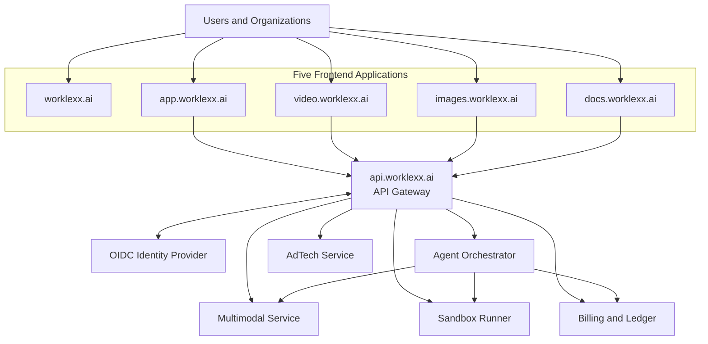
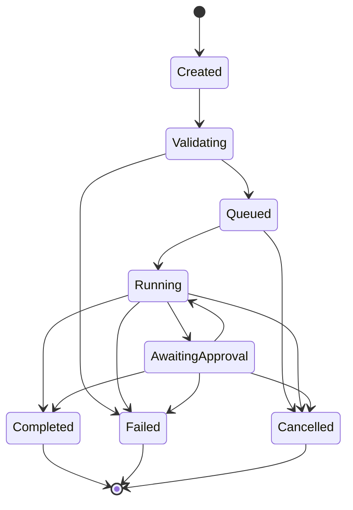
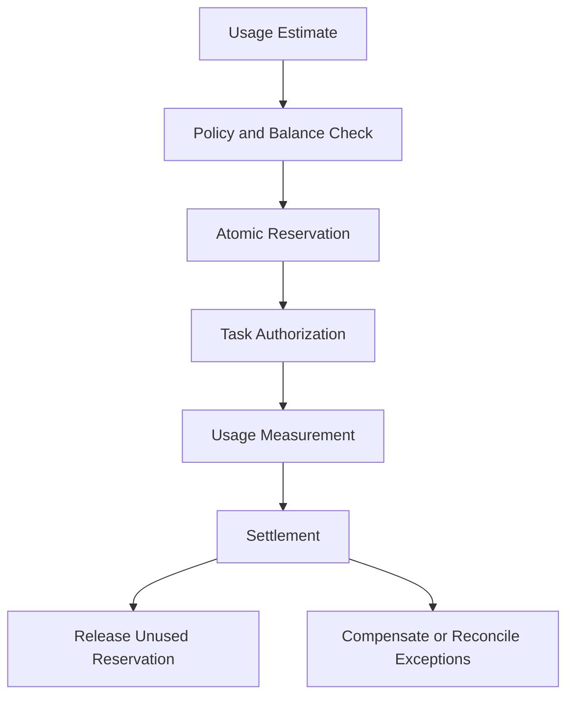

# Worklexx AI Software Factory — Architecture Overview

## Document Metadata

- **Document ID:** WLX-ARCH-001
- **Version:** 2.0 — Consolidated Architecture Baseline
- **Status:** Revised Architecture Blueprint — Awaiting Final Human Review and Explicit Approval
- **Author:** Lead Enterprise Software Architect, Principal AI Systems Engineer
- **Target Repository:** `https://github.com/samuel1599361/worklexx-ai-software-factory`
- **Classification:** Enterprise Technical Specification
- **Review Scope:** Phase 0 architecture documentation
- **Implementation Status:** Not yet authorized
- **Approval Authority:** Project Owner

---

## 1. Executive Summary

### 1.1 Purpose

The Worklexx AI Software Factory is an AI-powered software creation and delivery platform designed to help individuals, businesses, developers, and organizations plan, generate, inspect, test, improve, and manage software projects through coordinated AI agents and controlled execution workflows.

The platform is intended to provide an integrated environment for:

- AI-assisted software planning and requirements engineering.
- Full-stack application development.
- Multimodal input and output, including text, images, audio, and video.
- AI-assisted code generation, review, debugging, and testing.
- Controlled execution of generated code in isolated environments.
- Version-controlled project creation and management.
- AI-powered video, image, and document production.
- Usage measurement, billing, and credit management.
- Optional advertising and monetization capabilities.
- Human-supervised software delivery and deployment.

The platform is designed in Nigeria for international use and future global scalability.

The architecture uses permission-controlled AI agents, deterministic backend services, tenant-aware data controls, and explicit human approval gates. AI agents may recommend, plan, generate, and coordinate work, but they must not independently acquire unrestricted authority over financial operations, security controls, protected GitHub operations, or production deployments.

### 1.2 Architectural objective

The primary objective is to establish a secure, modular, scalable, and economically sustainable software factory that can evolve without requiring a complete architectural redesign whenever new AI models, agents, tools, or product capabilities are introduced.

The architecture separates:

1. User-facing applications.
2. API access and request enforcement.
3. AI orchestration and agent coordination.
4. Multimodal processing.
5. Sandboxed execution.
6. Financial and billing authority.
7. Advertising and monetization.
8. Persistent data, identity, security, and governance.

The architecture must support both individual users and organizational tenants while maintaining appropriate isolation of their projects, files, prompts, execution environments, usage records, and financial information.

### 1.3 Architecture status

This document describes a proposed architecture baseline pending Project Owner review and explicit approval. No ADR is recorded as Accepted or Conditionally Accepted at this revision.

It does not establish that:

- The platform has been implemented.
- The proposed cloud infrastructure has been provisioned.
- Security controls have been deployed.
- Database isolation has been implemented or tested.
- Payment integrations have been completed.
- AI agents have passed their evaluations.
- Sandbox isolation has been independently validated.
- Production-readiness requirements have been satisfied.

All implementation and operational claims require appropriate evidence.

---

## 2. Product Scope and Application Domains

The Worklexx AI Software Factory is organized around six official application domains.

| Domain | Primary responsibility | Application type |
|---|---|---|
| `worklexx.ai` | Corporate website, product information, public content, and acquisition | Public frontend |
| `app.worklexx.ai` | Main software factory, workspace, project management, and AI interaction | Main application frontend |
| `video.worklexx.ai` | AI-assisted video creation and management | Video frontend |
| `images.worklexx.ai` | AI-assisted image generation and management | Image frontend |
| `docs.worklexx.ai` | Documentation, guides, API references, and knowledge resources | Documentation frontend |
| `api.worklexx.ai` | Central API entry point for application and authorized external integrations | API Gateway domain |

The first five domains are frontend applications. The sixth is the separate API Gateway entry point.

The API Gateway is not a sixth frontend application and must not be confused with the identity provider.

### 2.1 Main application

`app.worklexx.ai` is the primary authenticated workspace.

It is intended to provide:

- User registration and account access.
- Organization and tenant management.
- Project creation and configuration.
- Requirements collection.
- AI conversation and task initiation.
- Agent activity and workflow visibility.
- Code and artifact inspection.
- Testing and execution results.
- Approval requests.
- Usage and billing information.
- Project history and audit access.
- Links to video, image, and documentation capabilities.

### 2.2 Video application

`video.worklexx.ai` provides the user interface for AI-assisted video workflows.

Potential capabilities include:

- Text-to-video requests.
- Image-to-video requests.
- Video editing and transformation.
- Scene and storyboard planning.
- Audio and subtitle workflows.
- Project asset management.
- Asynchronous generation status.
- Export and delivery.

Video generation may involve long-running jobs. It must not depend on a user-facing HTTP request remaining open for the full duration of a generation task.

### 2.3 Image application

`images.worklexx.ai` provides the user interface for image-related workflows.

Potential capabilities include:

- Text-to-image generation.
- Image editing.
- Image variations.
- Reference-image workflows.
- Asset organization.
- Image inspection and approval.
- Export and delivery.

Generated and uploaded images must follow tenant authorization, storage, retention, and content-safety requirements.

### 2.4 Documentation application

`docs.worklexx.ai` provides:

- Product documentation.
- User guides.
- Developer documentation.
- API references.
- Integration instructions.
- Security and operational guidance.
- Release information.

Documentation access may include public and authenticated content. Access to private project documentation must be tenant- and user-authorized.

### 2.5 API domain

`api.worklexx.ai` is the externally addressable API entry point.

It provides controlled access to application APIs and authorized integrations.

The API Gateway is responsible for request authentication and enforcement, routing, applicable rate limits, request validation, and policy enforcement.

It does not independently become the authoritative identity provider, financial ledger, or workflow engine.

---

## 3. Architectural Tenets

The architecture is governed by eight core tenets.

### Tenet 1 — Modular architecture with controlled service boundaries

The platform uses a modular architecture with six principal backend deployable units.

The 23 AI agents are logical software modules coordinated through the platform. They are not 23 independently deployed microservices.

Services must have explicit responsibilities, interfaces, authorization requirements, and data ownership boundaries.

A new agent or capability must not automatically create a new deployable service.

### Tenet 2 — AI agents coordinate; deterministic systems enforce

AI agents may:

- Interpret user requirements.
- Recommend technical designs.
- Generate code and documentation.
- Suggest changes.
- Invoke authorized tools.
- Coordinate other agents.
- Report progress and results.

AI agents must not independently:

- Bypass tenant authorization.
- Grant themselves additional permissions.
- Alter authoritative financial balances.
- Post arbitrary ledger entries.
- Declare an unverified payment successful.
- Approve their own protected GitHub operations.
- Approve their own production deployment.
- Override security policies.
- Disable mandatory audit controls.

Deterministic backend services enforce permissions, financial calculations, transaction boundaries, workflow state transitions, approval validation, and audit requirements.

### Tenet 3 — Tenant isolation and data ownership

The platform must enforce tenant isolation at application, database, object-storage, project, and execution-environment levels.

PostgreSQL Row-Level Security (RLS) is a required database security control, not a substitute for complete application authorization.

Tenant-owned database relationships must use appropriate tenant-aware constraints, including composite foreign keys where required.

RLS policies must be tested against:

- Cross-tenant read attempts.
- Cross-tenant writes.
- Missing tenant context.
- Incorrect tenant context.
- Connection-pool reuse.
- Background workers.
- Direct SQL access using application roles.
- Partitioned tables and their partitions.
- Privileged and administrative access paths.

Object storage, Git repositories, generated artifacts, and sandbox resources require their own tenant authorization controls.

### Tenet 4 — Centralized identity with application-specific authorization

The platform will use a centralized identity architecture based on an OpenID Connect (OIDC) identity provider and OAuth 2.0 Authorization Code Flow with Proof Key for Code Exchange (PKCE), subject to final identity-provider selection and approval.

The intended responsibilities are:

- The identity provider owns authentication, credentials, MFA, and identity-provider sessions.
- Worklexx application services own organization membership, tenant relationships, project permissions, and application-specific authorization.
- The API Gateway validates tokens and enforces applicable request-access policies.
- Individual services enforce their own resource-level authorization.

The architecture must not depend on sharing a broad authentication cookie across all parent-domain subdomains.

Host-only secure cookies and appropriate backend-for-frontend (BFF) session patterns should be used where applicable.

Token handling must address expiry, revocation, refresh-token rotation, reuse detection, key rotation, and session termination.

The managed identity-provider approach has been approved. Selection of a specific provider and its hosting arrangement remain subject to separate evaluation and human approval. The integration should remain provider-independent where practicable, and Worklexx services must continue to enforce application-level authorisation, tenant isolation, and resource-level access controls.

### Tenet 5 — Durable, recoverable workflow orchestration

Long-running software-generation and multimodal tasks require durable workflow management.

Temporal is a candidate workflow orchestration technology, subject to a proof of concept and final hosting decision.

Workflow execution must account for:

- Durable state.
- At-least-once activity execution where applicable.
- Idempotent operations.
- Bounded retries.
- Timeouts.
- Cancellation.
- Recovery.
- Compensation.
- Dead-letter handling.
- Reconciliation of external side effects.

Workflow replay and retries do not guarantee exactly-once execution of external actions.

External operations must use idempotency controls and reconciliation mechanisms.

Redis must not be treated as the authoritative durable workflow database.

### Tenet 6 — Secure sandboxed code execution

User-generated and AI-generated code must execute in isolated environments.

A dedicated GKE runner pool using gVisor is a candidate approach for proof-of-concept evaluation.

The platform must not assume that gVisor makes hostile code risk-free or that Cloud Run automatically provides the required isolation and runtime characteristics.

Sandbox security requirements include:

- Non-root execution.
- Restricted filesystem access.
- CPU, memory, process, disk, and execution-time limits.
- Default-deny network egress.
- Protection against cloud metadata access.
- DNS and IPv4/IPv6 controls.
- Short-lived credentials.
- No unnecessary host or service-account privileges.
- Controlled artifact exchange.
- Environment cleanup.
- Isolation testing and escape-attempt testing.

The final sandbox topology remains subject to validation.

### Tenet 7 — Deterministic financial operations

Financial operations must be performed by deterministic, auditable software.

The billing and ledger service must implement a genuine double-entry accounting model.

Financial requirements include:

- Atomic journal posting.
- Balanced debit and credit entries.
- Currency consistency.
- Idempotent financial operations.
- Verified payment-provider events.
- Credit reservations and settlement.
- Reversal through compensating entries.
- Immutable posted accounting records.
- Reconciliation.
- Auditable financial state transitions.

No AI agent may directly write authoritative balances or bypass the ledger's controlled posting interfaces.

Agent 21 may provide advisory financial reasoning and coordinate authorized requests, but financial decisions and execution remain subject to deterministic policy and billing services.

### Tenet 8 — Independent advertising and monetization controls

Advertising and monetization capabilities must be separated from private customer development activity.

The AdTech service may process approved advertising data and appropriately authorized public or aggregated information.

It must not receive or use:

- Private user prompts.
- Confidential source code.
- Private uploaded files.
- Credentials or access tokens.
- Secret keys.
- Private project content.
- Confidential execution logs.
- Non-public user activity.

The separation must be enforced through service identity, access policies, database permissions, storage permissions, network controls, and approved data interfaces.

This is a technical and governance separation requirement, not a claim of a cryptographic air gap.

---

## 4. High-Level System Topology

### 4.1 Frontend and API topology

The diagram describes logical request relationships, not every network connection or direct service dependency.

Actual service-to-service communication must use authenticated, authorized interfaces.

### 4.2 Six backend deployable units

| No. | Deployable unit | Primary responsibility |
|---:|---|---|
| 1 | `api-gateway` | API entry, authentication integration, request authorization enforcement, routing, rate limiting, and request policy |
| 2 | `agent-orchestrator` | Agent coordination, task planning, AI model routing capability, workflow coordination, and execution supervision |
| 3 | `multimodal-service` | Image, audio, video, and other multimodal ingestion and processing |
| 4 | `sandbox-runner` | Isolated execution, code testing, build operations, and controlled artifact production |
| 5 | `billing-ledger` | Credit reservations, usage settlement, payment records, financial accounting, and reconciliation |
| 6 | `adtech-service` | Approved advertising, campaign, advertiser, and monetization operations |

These six units represent the target logical deployment architecture.

Their final hosting topology, scaling configuration, network boundaries, and resource allocation remain subject to implementation planning and validation.

### 4.3 AI model gateway capability

The platform requires a model-provider abstraction to support model selection, routing, usage measurement, provider credentials, and provider-specific integration.

This capability is logically assigned within the proposed backend architecture and must not be introduced as an undocumented seventh deployable service.

Its exact deployment placement, interfaces, and ownership must be defined consistently in the system architecture and service-boundary documents.

The abstraction must not claim that different AI providers are perfectly interchangeable.

Model selection must account for:

- Supported capabilities.
- Input and output modalities.
- Context limits.
- Structured-output support.
- Tool-calling capabilities.
- Latency.
- Cost.
- Availability.
- Data handling and residency requirements.
- Safety and evaluation results.

Provider fallback must respect privacy, authorization, and data-residency policies.

---

## 5. Agent Ecosystem

### 5.1 Agent architecture

The Worklexx AI Software Factory is designed around 23 logical agents.

These agents operate as coordinated modules within the agent-orchestration architecture.

They do not receive unrestricted access to databases, cloud infrastructure, financial systems, or protected repositories.

Every agent must have a defined:

- Agent identifier.
- Name and purpose.
- Version.
- Responsible module.
- Input schema.
- Output schema.
- Tool permissions.
- Resource limits.
- Applicable approval gates.
- Evaluation criteria.
- Audit requirements.
- Failure and escalation behavior.

The authoritative agent catalogue is maintained in `AGENT_ECOSYSTEM.md`.

### 5.2 Agent authority

Agent permissions must follow least privilege.

An agent may only perform actions authorized for its assigned role and execution context.

Agent-generated output must be validated before it is accepted as authoritative system state.

### 5.3 Important agent boundaries

**Agent 17 — GitHub operations**

Protected repository operations require explicit authorization through the GitHub governance process.

Agent 17 must not grant itself elevated permissions or bypass protected-branch rules.

**Agent 18 — Documentation**

Documentation generation must respect repository and project boundaries. It must not automatically modify protected platform governance documents.

**Agent 19 — Code optimization**

Code optimization and configuration changes must have explicit path and permission boundaries.

**Agent 21 — Financial coordination**

Agent 21 may explain, recommend, and coordinate authorized financial actions.

It must not independently modify balances, create arbitrary ledger entries, or declare payment settlement.

The `billing-ledger` service remains the financial authority.

**Agent 22 — Multimodal operations**

Agent 22 coordinates multimodal tasks through authorized interfaces to the multimodal service.

Uploads and generated media must follow validation, quarantine, processing, authorization, and retention controls.

**Agent 23 — Advertising operations**

Agent 23 may support advertising workflows through the AdTech service.

It must not access private customer prompts, source code, uploaded project assets, credentials, or confidential development activity.

---

## 6. Core Software Factory Lifecycle

### 6.1 Task lifecycle

Every software-generation task must be managed through an explicit, auditable state machine.

The baseline lifecycle is:

The state machine must be enforced by deterministic backend logic.

Agents may request transitions, but they cannot independently override transition rules.

The implementation must define:

- Permitted state transitions.
- Transition authorization.
- State persistence.
- Idempotency.
- Retry behavior.
- Cancellation semantics.
- Timeout behavior.
- Approval expiry.
- Recovery behavior.
- Audit events.

### 6.2 Task execution

A typical task follows this sequence:

1. The user submits a software request.
2. The API Gateway authenticates and authorizes the request.
3. The system validates tenant, project, and user permissions.
4. The orchestrator creates a durable task record.
5. Relevant agents are selected.
6. The task is queued or scheduled.
7. Agents perform authorized planning and generation.
8. Generated artifacts are validated.
9. Required tests and sandbox execution are performed.
10. The user receives progress and results.
11. Required human approvals are requested.
12. Authorized artifacts are published to the appropriate project destination.
13. The task reaches a valid terminal state.
14. Usage is measured and submitted for deterministic settlement.

Not every task requires every step. The workflow must select the applicable steps based on task type, risk, permissions, and policy.

### 6.3 User-visible execution information

The platform should expose useful execution information, including:

- Current task status.
- Progress indicators.
- Agent activity summaries.
- Tool activity.
- Test results.
- Generated artifacts.
- Error messages.
- Approval requests.
- Execution logs where authorized.

Private model chain-of-thought must not be exposed as a user-facing execution feature.

The platform should provide concise explanations, status information, and verifiable execution evidence instead.

---

## 7. Human Approval and Governance Gates

The platform requires six human-in-the-loop governance gates.

The six gates and their initial approval authority have been approved under HD-08. During the initial governance phase, the Project Owner is the sole approval authority for all six gates; specialists may assess and advise but do not approve on the Project Owner's behalf.

The following distinctions are mandatory.

### 7.1 GATE-03 — Production deployment approval

GATE-03 controls authorization to deploy a specific approved artifact to a production environment.

Approval must be bound to relevant execution context, including:

- Project.
- Tenant.
- Target environment.
- Artifact identity or digest.
- Relevant source revision.
- Requested deployment action.
- Approver identity.
- Approval timestamp.
- Expiry and revocation status.

A material change to the approved artifact or deployment context must invalidate or require reassessment of the approval.

### 7.2 GATE-04 — Protected GitHub operations approval

GATE-04 controls protected GitHub operations as defined by the repository governance policy.

Depending on the final approved scope, these may include:

- Protected-branch operations.
- Pull-request merge operations.
- Protected release or tag operations.
- Other explicitly restricted repository actions.

GATE-04 is separate from production deployment approval.

Permission to merge or publish code does not automatically authorize production deployment.

### 7.3 GATE-01, GATE-02, GATE-05 and GATE-06

- **GATE-01 — Product and architecture change:** Material changes to product scope, platform architecture, service boundaries, security design, technology choices or approved architectural decisions.
- **GATE-02 — Financial and resource commitment:** Cloud/infrastructure commitments, AI model/API commitments, paid licences, vendor contracts or recurring subscriptions, and material budget increases. No spending thresholds or delegated financial limits are established.
- **GATE-05 — Destructive database operations and migrations:** Irreversible destruction, invalidation or material transformation of persistent data or database structures, including destructive schema changes, incompatible transformations, bulk deletion and production resets/restores that overwrite existing data. Require verified backups, impact analysis, execution plan and rollback/recovery strategy.
- **GATE-06 — Consequential external integrations and live-account actions:** External integrations or live actions with material financial, operational, customer, legal or security consequences, including live payments, production identity-provider activation, live customer messaging and consequential financial, insurance or logistics actions. Require due diligence, permission review, test evidence, data-protection assessment and rollback/suspension plan.

### 7.4 Gate enforcement principles

All gates require authenticated human approval enforced by deterministic controls outside the AI model. Approval must be explicit, action- and context-bound, auditable, time-limited, revocable and protected against replay. Records must bind the approver, decision, scope, project/tenant, environment and affected resource or artifact as applicable, evidence, timestamp, expiry and revocation state.

Material changes require invalidation or reassessment. The system must fail closed when approval is absent, invalid, expired, revoked or unverifiable. Silence, prior approvals, general project approval, technical permissions, administrator status or risk acceptance do not constitute approval. AI agents may prepare requests and evidence but may not approve, impersonate an approver or override controls.

The gates are independent and cumulative where applicable. GATE-03 production deployment and GATE-04 protected GitHub operations remain separate. Architecture approval does not authorise implementation; financial approval does not authorise production deployment; risk acceptance is not gate approval. Emergency procedures require separate documentation and approval and may not create an undocumented bypass.

### 7.5 Gate decision register

| Gate | Approved control area | Authority and key evidence |
|---|---|---|
| GATE-01 | Product and architecture change | Project Owner; specialist assessment for material security, legal, privacy or infrastructure changes |
| GATE-02 | Financial and resource commitment | Project Owner; no spending thresholds or delegated financial limits established |
| GATE-03 | Production deployment | Project Owner; bind approved artifact/commit, target environment, action, validation evidence and rollback plan |
| GATE-04 | Protected GitHub operations | Project Owner; bind repository, branch/protected resource, operation and relevant PR/commit; distinct from PR review |
| GATE-05 | Destructive database operations and migrations | Project Owner; verified backups, impact analysis, migration/execution plan and rollback/recovery strategy |
| GATE-06 | Consequential external integrations and live-account actions | Project Owner; provider due diligence, permissions review, test evidence, data-protection assessment and rollback/suspension plan |

---

## 8. Data Architecture and Storage Responsibilities

### 8.1 Authoritative data systems

The platform uses different storage systems for different data responsibilities.

| Technology | Intended responsibility | Authority boundary |
|---|---|---|
| PostgreSQL | Tenant records, application metadata, project state, financial records, workflow references, and audit metadata | Authoritative transactional database |
| Redis | Cache, transient coordination, rate-limit counters, and ephemeral hints | Not authoritative for financial or durable workflow state |
| Object storage | Uploaded files, generated assets, media, and execution artifacts | Authoritative for stored object bytes, subject to metadata and access controls |
| GitHub/Git repositories | Source-code history, branches, commits, and pull requests | Authoritative source-control history |
| Temporal, if selected | Durable workflow execution state and orchestration | Workflow authority within its defined scope |
| Pub/Sub | Asynchronous event transport and notifications | Not the authoritative business record or artifact store |

The final storage products and hosting arrangements require implementation validation.

### 8.2 Data ownership

Each backend service must have explicit ownership of its business records.

Services should not bypass another service's authority by writing directly to its database tables.

Where cross-service data is required, use documented interfaces, events, or explicitly approved read models.

### 8.3 Object and artifact lifecycle

Uploaded files must not be treated as clean or trusted merely because they have been received.

The intended lifecycle is:

`Received → Pending → Quarantined → Scanning → Clean or Rejected → Released`

The exact processing stages may vary by file type.

Controls must address:

- File type and signature validation.
- Size and decompression limits.
- Malware scanning.
- Parser isolation.
- Access permissions.
- Retention and deletion.
- Versioning.
- Audit events.
- Safe delivery through appropriately scoped access mechanisms.

### 8.4 Embedding and vector data

Embedding records must preserve metadata sufficient to identify:

- Tenant and applicable access scope.
- Source record or artifact.
- Embedding model and version.
- Vector dimensions.
- Generation timestamp.
- Data classification.
- Retention and deletion status.

Embedding dimensions must be selected according to the chosen model and use case; dimensions such as 768, 1,536, and 3,072 must not be mixed in an incompatible logical index. PostgreSQL with pgvector is the approved preferred initial vector-storage approach, subject to POC-05. The POC must validate index compatibility, exact and approximate retrieval quality, relevant full-precision and half-precision options, performance, tenant filtering, lifecycle, and migration strategy. A 3,072-dimensional configuration is not a platform-wide requirement.

---

## 9. Financial Architecture

### 9.1 Financial authority

The `billing-ledger` service is the authoritative financial service.

It is responsible for:

- Account and balance management.
- Credit reservations.
- Usage settlement.
- Payment-provider event processing.
- Journal creation and posting.
- Refunds and reversals.
- Reconciliation.
- Financial audit records.

AI agents may request financial operations through approved interfaces but cannot write authoritative balances.

### 9.2 Double-entry accounting

Financial transactions must use balanced double-entry accounting.

For each posted journal:

\[
\sum \text{Debits} = \sum \text{Credits}
\]

The equality must hold for the applicable accounting currency and transaction.

Posted entries must be immutable through ordinary application interfaces.

Corrections and reversals must use controlled compensating entries.

The database posting process must enforce the controlled transition from draft to posted while preventing direct modification of posted financial records.

### 9.3 Credit lifecycle

The intended credit lifecycle is:

A reservation is not a completed charge.

The system must distinguish estimated cost, reserved amount, actual usage, settled amount, and released amount.

### 9.4 Payment-provider integration

Paystack and Stripe are intended payment-provider integrations, subject to rollout planning and approval.

Provider-specific webhook verification must be implemented.

For Paystack, the documented signature-verification procedure uses HMAC-SHA512. Verification must use the appropriate raw request body and secret, with secure comparison and the provider's current specification.

Stripe must use its provider-specific signature-verification procedure.

For all providers:

- Verify webhook authenticity.
- Persist verified events before acknowledging successful processing where required by the integration design.
- Deduplicate provider event identifiers.
- Enforce idempotent financial processing.
- Reject browser redirects as proof of payment.
- Reconcile provider records with internal financial records.
- Preserve audit evidence.

Provider-specific behavior must not be assumed interchangeable.

---

## 10. Security Architecture

Security is a cross-cutting architectural requirement.

The platform must implement defence in depth across:

1. Identity and authentication.
2. Application authorization.
3. Tenant isolation.
4. API access.
5. Service-to-service identity.
6. Database security.
7. Object-storage security.
8. Sandbox isolation.
9. AI prompt and tool security.
10. Financial integrity.
11. GitHub permissions.
12. Audit and monitoring.
13. Secrets and cryptographic key management.
14. Privacy and data lifecycle.

### 10.1 Prompt injection and tool authorization

User prompts, uploaded documents, web content, generated code, and other external inputs must be treated as untrusted data.

Prompt-injection protection must not rely exclusively on model instructions.

Tool permissions must be enforced outside the model by deterministic authorization controls.

An agent must not gain new authority merely because a prompt, document, or tool output requests it.

### 10.2 Service identities

Each backend deployable unit must have a distinct service identity or appropriately scoped workload identity.

Service credentials must follow least privilege and support expiry, rotation, revocation, and audit.

### 10.3 Secrets and cryptographic keys

The architecture must distinguish application secrets from cryptographic keys.

Key management must define:

- Key ownership.
- Key purpose.
- Key version.
- Encryption and decryption permissions.
- Rotation schedule.
- Revocation.
- Recovery.
- Audit.
- Incident response.

KMS use alone does not prove that every application secret or cryptographic key is automatically rotated.

### 10.4 Privacy and cross-border processing

The platform must maintain a data-processing inventory and identify applicable legal requirements for the jurisdictions in which it operates.

Cross-border processing must be assessed by purpose, data category, destination, recipient, applicable legal mechanism, and onward-transfer conditions.

Legal compliance and certification must not be claimed solely because a technical control exists.

The detailed security requirements are specified in `SECURITY_ARCHITECTURE.md`.

---

## 11. Scalability and Availability

The architecture is intended to support growth in:

- Users.
- Organizations and tenants.
- Concurrent projects.
- AI tasks.
- Agent executions.
- Model-provider requests.
- Multimodal uploads.
- Video and image generation.
- Sandbox jobs.
- Payment transactions.
- Advertising operations.
- Stored artifacts.

Scaling must be based on workload characteristics rather than a single global concurrency assumption.

Long-running tasks must use asynchronous execution and durable state management.

Services must define appropriate limits for:

- Requests per user and tenant.
- Concurrent workflows.
- Agent execution.
- Model-provider calls.
- Upload sizes.
- Media duration and processing.
- Sandbox resource consumption.
- Storage consumption.
- Billing and financial operations.

The platform must implement graceful degradation when a model provider, workflow engine, payment provider, storage service, or other dependency is unavailable.

Critical financial and authorization operations must fail safely rather than silently proceeding without their required controls.

---

## 12. Non-Functional Requirements

The following NFR categories form the architecture baseline.

Numerical values must be recorded as proposed, approved, measured, or validated. A proposed target is not evidence of achieved performance.

| ID | Requirement | Measurement and acceptance approach | Status |
|---|---|---|---|
| NFR-01 | User-facing responsiveness | Measure frontend interaction and API latency separately using defined percentiles and workload conditions | Target to be approved |
| NFR-02 | API performance | Measure endpoint latency, throughput, error rate, and concurrency | Target to be approved |
| NFR-03 | Workflow durability | Test persistence, worker failure, retry, cancellation, and recovery | Validation required |
| NFR-04 | Financial integrity | Test balanced journals, atomicity, idempotency, concurrency, and reconciliation | Mandatory acceptance requirement |
| NFR-05 | Tenant isolation | Perform adversarial cross-tenant database, API, storage, and project-access tests | Mandatory acceptance requirement |
| NFR-06 | Sandbox isolation | Test network, filesystem, process, resource, credential, and escape boundaries | PoC and security validation required |
| NFR-07 | Multimodal processing | Measure processing time, failure rate, throughput, and recovery by media type | Target to be approved |
| NFR-08 | Availability | Define service-specific availability objectives and measurement windows | Target to be approved |
| NFR-09 | Recovery | Define RPO and RTO for each critical data and service category | Human decision pending |
| NFR-10 | Observability | Verify logs, metrics, traces, alerts, and audit events | Implementation required |
| NFR-11 | Accessibility | Test against an approved accessibility standard and representative user workflows | Target to be approved |
| NFR-12 | Cost efficiency | Measure infrastructure, model, storage, media, and execution costs | Baseline required |
| NFR-13 | Data retention | Verify retention, archival, deletion, legal holds, and backup handling | Policy approval required |
| NFR-14 | Security | Execute security testing, vulnerability management, and incident exercises | Implementation and evidence required |

### 12.1 Performance measurement rules

Performance results must specify:

- Test environment.
- Software and model versions.
- Workload.
- Dataset.
- Concurrency.
- Measurement interval.
- Percentile.
- Error rate.
- Resource configuration.
- Measurement date.

A benchmark result must not be presented as a universal guarantee.

### 12.2 Recovery objectives

RPO and RTO must not be declared final until the complete recovery architecture has been tested.

Recovery planning must cover all critical dependencies, including:

- PostgreSQL.
- Financial records.
- Workflow state.
- Object storage.
- Source repositories.
- Identity and key-management dependencies.
- Application configuration.
- Secrets.
- Infrastructure definitions.
- Audit evidence.

Database high availability alone does not establish full-platform disaster recovery.

---

## 13. Observability, Audit, and Operational Governance

The platform must provide centralized observability appropriate to its distributed architecture.

### 13.1 Logs

Logs must support investigation without unnecessarily exposing:

- Passwords.
- Access tokens.
- API keys.
- Private prompts.
- Confidential source code.
- Sensitive personal data.
- Payment credentials.

### 13.2 Metrics

Metrics should cover:

- Request volume.
- Latency.
- Error rates.
- Workflow queues.
- Worker health.
- Agent execution.
- Model-provider availability.
- Token and usage consumption.
- Sandbox resource usage.
- Payment processing.
- Ledger reconciliation.
- Storage capacity.
- Advertising operations.

### 13.3 Distributed tracing

Trace identifiers should connect related API requests, workflows, agent executions, service calls, and asynchronous operations where appropriate.

### 13.4 Audit events

Audit records must capture security- and business-relevant actions, including:

- Authentication and session events.
- Tenant membership changes.
- Permission changes.
- Approval creation and use.
- Protected GitHub operations.
- Deployment authorization.
- Financial operations.
- Payment-provider events.
- Data export and deletion.
- Administrative access.
- Security incidents.

Audit records require appropriate integrity protection, access control, and retention.

---

## 14. Technology Decisions and Deferred Choices

The architecture identifies candidate technologies but does not convert every candidate into an approved implementation decision.

| Area | Candidate or direction | Decision status |
|---|---|---|
| Frontend | Next.js and React applications | Architectural direction; version and runtime validation required |
| Frontend hosting | Vercel | Hosting direction; exact runtime and ingress design require validation |
| Backend | Python and FastAPI | Architectural direction; dependency versions must be pinned |
| Primary database | PostgreSQL | Architectural direction; hosting and configuration require approval |
| Vector database capability | PostgreSQL with pgvector | Approved preferred initial approach; specific configuration subject to POC-05 |
| Workflow orchestration | Temporal | Temporal Cloud preferred initially, subject to POC-06 and due diligence; self-hosted retained as a future alternative |
| Event transport | Google Cloud Pub/Sub | Candidate; delivery and recovery semantics must be specified |
| Cache | Redis | Ephemeral cache and coordination role |
| Object storage | Cloud object storage | Candidate; provider, region, retention, and recovery require approval |
| Sandbox | GKE runner pool with gVisor | Candidate; PoC and security testing required |
| Identity | OIDC provider with OAuth 2.0 PKCE | Architectural direction; final provider remains unresolved |
| Payments | Paystack and Stripe | Integration direction; rollout priority remains unresolved |
| AI providers | Multiple provider integrations through an abstraction | Capability-based integration and evaluation required |
| AdTech | Separate AdTech service | Architectural separation required |

Exact versions, supported runtime configurations, provider capabilities, pricing, quotas, and service-level commitments must be validated against current authoritative documentation before implementation.

---

## 15. Architecture Dependencies and Human Decisions

The following decisions must be resolved by the Project Owner or the appropriately designated authority.

| ID | Decision | Current status |
|---|---|---|
| HD-01 | Managed identity provider versus internally operated identity solution | **Approved — managed approach (2026-11-19)** |
| HD-02 | Temporal Cloud versus self-hosted Temporal | **Approved — Temporal Cloud preferred initial approach, conditional on POC-06 and due diligence (2026-11-19)** |
| HD-03 | Primary and disaster-recovery cloud regions | **Approved — AWS primary Cape Town (`af-south-1`), Ireland DR (`eu-west-1`), and Temporal Cloud Ireland (`aws-eu-west-1`), architectural direction only, subject to validation (2026-11-19)** |
| HD-04 | Final deployment topology for the six backend deployables | **Approved — six logical deployables; physical topology validation pending (2026-11-19)** |
| HD-05 | PostgreSQL/pgvector initial vector-storage approach and model-specific embedding dimensions | **Approved — preferred initial approach; POC-05 and configuration validation required (2026-11-19)** |
| HD-06 | Final RPO and RTO | **Approved — tiered architectural objectives; POC-15 and operational validation required (2026-11-19)** |
| HD-07 | Risk acceptance authority and delegation | **Approved — Project Owner sole risk acceptance authority during initial governance phase; no delegation (2026-11-19)** |
| HD-08 | Definitions, authority and enforcement for GATE-01 through GATE-06 | **Approved — six-gate human approval framework; Project Owner sole gate approval authority during initial governance phase (2026-11-19)** |

Additional decisions requiring explicit resolution include:

- DNS and domain-management provider.
- Payment-provider rollout priority.
- Sandbox hosting and isolation design.
- Production ingress and WAF architecture.
- Final repository branching strategy.
- Hosting and data-residency constraints.
- Initial commercial and usage-pricing model.

A technical recommendation is not a Project Owner decision.

A proposed ADR is not an accepted ADR.

An accepted architectural decision does not establish that its implementation has been completed or verified.

---

## 16. Architecture Acceptance Criteria

This architecture may be considered ready for formal Phase 0 architectural approval only after the Project Owner has reviewed the complete documentation set and the required governance decisions have been recorded.

The following conditions must be addressed:

1. The five frontend applications and separate API Gateway are consistently defined.
2. The six backend deployable units are consistently defined.
3. The 23 logical agents have documented roles and permission boundaries.
4. The identity-provider, Gateway, and application-authorization responsibilities are separated.
5. Financial operations are restricted to deterministic financial services.
6. Tenant isolation requirements are documented across database, object storage, Git, and execution environments.
7. The workflow architecture defines durable state, idempotency, retries, cancellation, and recovery.
8. Sandbox isolation has a defined validation plan.
9. AdTech separation is technically and operationally specified.
10. GATE-03 and GATE-04 are independent and enforceable.
11. Unresolved decisions are explicitly recorded.
12. Risk ownership and risk acceptance authority are defined.
13. NFR targets are classified and have measurement methods.
14. The remaining Phase 0 documents are mutually consistent.
15. The Project Owner explicitly approves the architecture.

Approval of this document alone does not authorize Phase 1.

---

## 17. Phase 0 Execution Boundary

### 17.1 Authorized Phase 0 scope

The current Phase 0 activity is limited to architecture documentation review, correction, consistency assessment, and evidence-based verification within the authorized document scope.

The existing repository starter files must be preserved.

The original backup and SHA-256 baseline must remain untouched.

### 17.2 Activities not authorized by this document

This architecture document does not authorize:

- Application implementation.
- New service scaffolding.
- Database migrations.
- Production code changes.
- Cloud provisioning.
- Deployment.
- CI/CD activation.
- Protected GitHub operations.
- Payment integration activation.
- Production credentials or secret creation.
- Changes to existing repository files outside the authorized documentation scope.

### 17.3 Phase 1 authorization

Phase 1 may commence only after:

1. All 16 Phase 0 documents have undergone final review.
2. Cross-document inconsistencies have been resolved or formally accepted.
3. Required human decisions have been recorded.
4. The Project Owner has explicitly approved Phase 0.
5. The Project Owner has separately authorized Phase 1 activities.

---

## 18. Related Architecture Documents

This document must be read together with:

| Document | Document ID | Primary subject |
|---|---|---|
| `SYSTEM_ARCHITECTURE.md` | WLX-ARCH-002 | Detailed system design |
| `TECHNOLOGY_STACK.md` | WLX-ARCH-003 | Technology selection and validation |
| `REPOSITORY_STRUCTURE.md` | WLX-ARCH-004 | Repository and package organization |
| `AGENT_ECOSYSTEM.md` | WLX-ARCH-005 | Twenty-three-agent specifications |
| `SERVICE_BOUNDARIES.md` | WLX-ARCH-006 | Backend service responsibilities |
| `DATABASE_ARCHITECTURE.md` | WLX-ARCH-007 | Database and data ownership |
| `SECURITY_ARCHITECTURE.md` | WLX-ARCH-008 | Security controls |
| `DEPLOYMENT_ARCHITECTURE.md` | WLX-ARCH-009 | Deployment topology |
| `DEVELOPMENT_ROADMAP.md` | WLX-ARCH-010 | Phased implementation roadmap |
| `RISK_REGISTER.md` | WLX-ARCH-011 | Enterprise risk management |
| `ADR_REGISTER.md` | WLX-ARCH-012 | Architecture decisions |
| `PHASE_0_INSPECTION_REPORT.md` | WLX-ARCH-013 | Baseline and revision evidence |
| `TESTING_STRATEGY.md` | WLX-ARCH-014 | Verification and test approach |
| `MONITORING_AND_OBSERVABILITY.md` | WLX-ARCH-015 | Monitoring, metrics, logs, and traces |
| `COST_AND_SCALABILITY.md` | WLX-ARCH-016 | Cost, capacity, and scalability |

Where a detailed document defines an implementation-level requirement, it must remain consistent with the architectural principles and boundaries in this overview.

Contradictions must be resolved through controlled documentation revision and, where applicable, a recorded architecture decision.

---

## 19. Final Status

**Architecture review and correction cycle in progress — awaiting final verification and explicit human approval.**

This document is a consolidated architecture blueprint.

It is not an implementation report, security certification, production-readiness declaration, or authorization to commence Phase 1.

**Phase 1 remains unauthorized until separate explicit approval is granted by the Project Owner.**

---

**End of Document — WLX-ARCH-001**

## HD-03 — Approved Regional Architecture Direction (2026-11-19)

- **Cloud provider:** Amazon Web Services (AWS).
- **Primary hosting region:** South Africa (Cape Town), AWS region `af-south-1`.
- **Disaster-recovery region:** Ireland (Dublin), AWS region `eu-west-1`.
- **Temporal Cloud preferred region:** Ireland, Temporal Cloud region identifier `aws-eu-west-1`, subject to POC-06 and due diligence.
- **Scope:** Architectural direction only. No subscription, contract, payment, account configuration, resource provisioning, or production deployment is authorised.
- **Conditions:** Complete legal and privacy assessment (including Nigerian data-protection and cross-border-transfer requirements), security review, service availability and compatibility validation, POC and operational readiness, cost review, and recovery design/testing. Confirm the required data-residency, backup, retention, encryption, key-management, monitoring and incident-response controls.
- **Lagos Local Zone:** Any use is optional and separately evaluated; it is not treated as an independent AWS Region or as proof of full Nigerian data residency.
- **Reversibility:** Region and provider selection may be revisited based on validation evidence or requirements changes.
