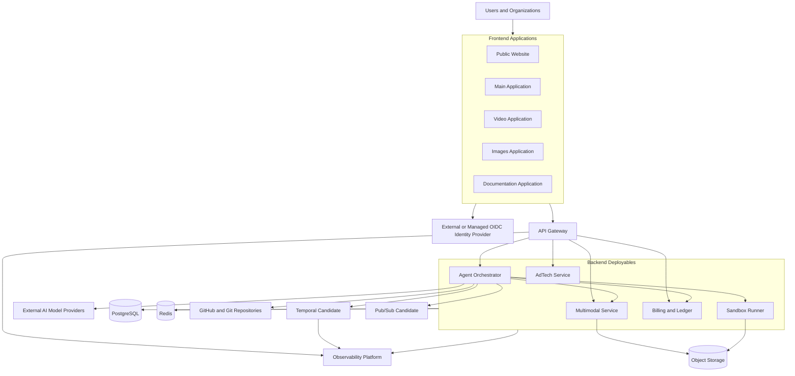
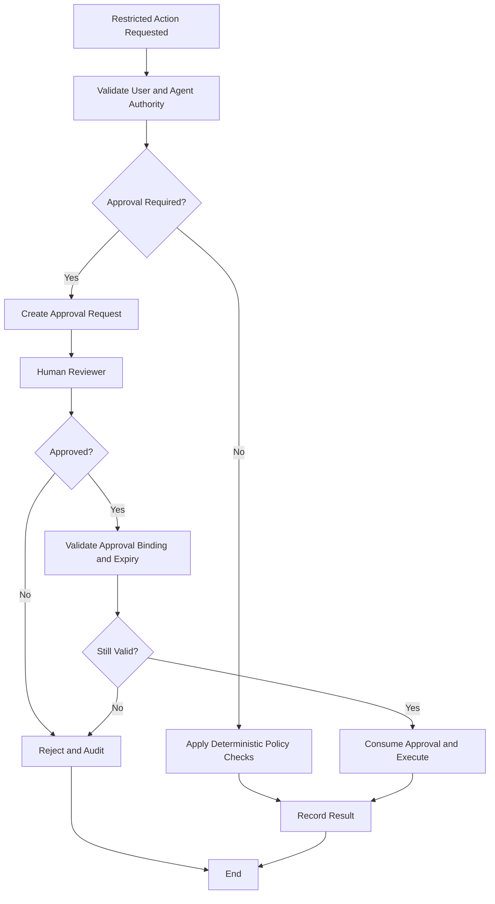

# Worklexx AI Software Factory — System Architecture

## Document Metadata

| Field | Description |
|---|---|
| Document ID | WLX-ARCH-002 |
| Document Title | System Architecture |
| Platform | Worklexx AI Software Factory |
| Repository | `https://github.com/samuel1599361/worklexx-ai-software-factory` |
| Classification | Enterprise Technical Specification |
| Document Status | Revised Architecture Blueprint — Phase 0 Revision Cycle |
| Approval Status | Awaiting final verification and explicit Project Owner approval |
| Supersedes | Previous Phase 0 draft of this document |
| Related Document | `ARCHITECTURE_OVERVIEW.md` — WLX-ARCH-001 |

---

## 1. Purpose

This document defines the detailed system architecture of the Worklexx AI Software Factory.

It describes the major application components, backend deployables, service responsibilities, communication patterns, workflow orchestration, AI integration, security boundaries, data ownership, financial controls, and operational requirements.

The purpose is to establish a consistent technical blueprint before implementation begins.

This document is architectural guidance. It does not establish that any proposed component has been implemented, deployed, tested, or certified.

## 2. Architectural Objectives

The system is designed to:

1. Provide a unified environment for AI-assisted software development.
2. Support multiple users, organizations, tenants, and projects.
3. Coordinate 23 logical AI agents through controlled orchestration.
4. Support text, image, audio, and video-related workflows.
5. Integrate multiple AI model providers through a controlled abstraction.
6. Generate, validate, test, and manage software artifacts.
7. Provide isolated execution environments for untrusted generated code.
8. Support controlled GitHub and repository operations.
9. Enforce deterministic financial authorization, billing, and ledger operations.
10. Support subscription, usage-based billing, and credit reservation workflows.
11. Provide a separately governed advertising capability.
12. Maintain auditable task execution and human approval processes.
13. Support future scaling without treating every logical agent as a separate microservice.

The architecture prioritizes security, tenant isolation, financial integrity, maintainability, observability, and controlled automation.

## 3. System Context

### 3.1 Platform domains

The proposed platform uses six official domains.

| Domain | Responsibility |
|---|---|
| `worklexx.ai` | Public website, product information, and marketing |
| `app.worklexx.ai` | Main application and authenticated user workspace |
| `video.worklexx.ai` | Video-related user interface and workflows |
| `images.worklexx.ai` | Image-related user interface and workflows |
| `docs.worklexx.ai` | Documentation and knowledge resources |
| `api.worklexx.ai` | Central API Gateway and external API entry point |

The five frontend applications are separate from the API Gateway.

Their final deployment topology, authentication integration, ingress protection, and hosting configuration must be validated before implementation.

### 3.2 High-level system context

The platform consists of the following logical areas:

- User-facing applications.
- Identity and authentication.
- API Gateway.
- Agent orchestration.
- Multimodal processing.
- Isolated sandbox execution.
- Billing and ledger management.
- Advertising operations.
- Persistent storage.
- External AI and business-service integrations.
- Observability and security operations.

The following diagram represents logical relationships, not a final network deployment topology.

The diagram does not authorize direct unrestricted access between services. Each communication path must be implemented through documented interfaces and scoped service identities.

## 4. Frontend Architecture

### 4.1 Frontend applications

The five frontend applications provide distinct user experiences while sharing approved platform services.

**Public website — `worklexx.ai`**

Responsibilities:

- Product and platform information.
- Public marketing content.
- Registration entry points.
- Public announcements.
- Approved public resources.

It must not expose confidential application or tenant data.

**Main application — `app.worklexx.ai`**

Responsibilities:

- User registration and authentication flows.
- Organization and tenant workspaces.
- Project creation and management.
- Software-generation requests.
- Agent task monitoring.
- Approval interfaces.
- Billing and subscription interfaces.
- Artifact and repository access.
- User and organization settings.

**Video application — `video.worklexx.ai`**

Responsibilities:

- Video workflow interfaces.
- Video-generation requests.
- Media upload and processing interactions.
- Job progress and result presentation.
- Authorized artifact access.

**Images application — `images.worklexx.ai`**

Responsibilities:

- Image-generation interfaces.
- Image editing requests.
- Image asset management.
- Processing status.
- Authorized output retrieval.

**Documentation application — `docs.worklexx.ai`**

Responsibilities:

- User documentation.
- Product guides.
- API documentation.
- Technical references.
- Approved knowledge resources.

### 4.2 Frontend state management

The proposed frontend state-management approach separates:

- Local interface state.
- Shared client-side state.
- Server-owned application state.
- Durable workflow state.

Zustand is a candidate for selected client-side interface state.

TanStack Query is a candidate for server-state retrieval, caching, synchronization, and mutation handling.

The backend remains authoritative for:

- Authentication and authorization decisions.
- Tenant and project permissions.
- Task lifecycle state.
- Approval status.
- Financial balances.
- Usage settlement.
- Artifact ownership.
- Workflow completion.

Frontend state must never be treated as proof of authorization or financial status.

### 4.3 Real-time updates

Server-Sent Events (SSE) or WebSockets may be used for real-time task updates.

The final transport selection depends on the interaction requirements and implementation validation.

Real-time messages should communicate:

- Task status.
- Progress.
- Agent activity summaries.
- Tool execution status.
- Test results.
- Approval requests.
- Errors.
- Artifact availability.

The frontend must handle disconnections, reconnection, duplicate messages, missed updates, and state resynchronization.

The backend or durable workflow engine remains authoritative.

Private model chain-of-thought must not be exposed through real-time updates.

## 5. Identity and Authentication Architecture

### 5.1 Identity-provider responsibility

The identity provider is responsible for authentication-related functions, including:

- User credential verification.
- Multi-factor authentication where supported and configured.
- Identity-provider sessions.
- Authentication policies.
- Token issuance.
- Identity-provider account recovery.

The final identity-provider choice remains pending.

### 5.2 Worklexx application responsibility

Worklexx owns application-level authorization and organizational relationships, including:

- Organization memberships.
- Tenant membership.
- Project permissions.
- Application roles.
- Resource access policies.
- Agent execution permissions.
- Approval authority.
- Organization-level settings.

Authentication does not automatically grant access to every organization, tenant, project, or resource.

### 5.3 API Gateway responsibility

The API Gateway must:

1. Validate access tokens.
2. Enforce applicable request-level authorization policies.
3. Apply request validation and rate limits.
4. Establish trusted request context.
5. Route requests to authorized backend services.
6. Apply security and observability controls.
7. Reject invalid or unauthorized requests.

The Gateway is not the identity provider and must not assume responsibility for issuing user identities or credentials.

### 5.4 OIDC and OAuth 2.0

The preferred authentication direction is OpenID Connect using the OAuth 2.0 Authorization Code flow with PKCE.

The implementation must address:

- Exact redirect URI validation.
- State validation.
- Nonce validation.
- PKCE challenge and verifier handling.
- Secure session establishment.
- CSRF protection.
- Token expiration.
- Refresh-token rotation and reuse detection where supported.
- Session revocation and logout.
- Issuer and audience validation.

For a Backend-for-Frontend (BFF) design, the PKCE verifier should be retained server-side rather than exposed to browser JavaScript.

Session cookies must use appropriate security attributes.

Where a `__Host-` cookie prefix is used, the cookie must satisfy the applicable browser requirements, including `Secure`, `Path=/`, and the absence of a `Domain` attribute.

### 5.5 JWT validation

Services accepting JWT access tokens must enforce an approved validation policy.

At minimum, this must include:

- Explicit signing-algorithm allowlisting.
- Rejection of `none`.
- Signature validation.
- Issuer validation.
- Audience validation.
- Expiration validation.
- Not-before validation.
- Subject validation.
- Appropriate key identification and JWKS handling.
- Key rotation.
- Revocation or other applicable session invalidation controls.
- Scope and permission checks.

Services must not trust token claims merely because a token is syntactically valid.

### 5.6 Identity and service authorization separation

User authentication, application authorization, and service-to-service identity are separate responsibilities.

A valid user token does not automatically authorize a backend service to access another service's private database or infrastructure.

Each service must independently enforce its documented authorization boundary.

## 6. Backend Architecture

### 6.1 Six backend deployable units

The baseline architecture defines six deployable backend units.

| No. | Deployable | Primary responsibility |
|---|---|---|
| 1 | `api-gateway` | API entry point, authentication validation, request authorization, routing, and ingress controls |
| 2 | `agent-orchestrator` | Agent coordination, planning, workflow initiation, task management, and model-routing coordination |
| 3 | `multimodal-service` | Image, audio, video, and other multimodal processing workflows |
| 4 | `sandbox-runner` | Isolated execution of generated or otherwise untrusted code |
| 5 | `billing-ledger` | Financial accounts, reservations, payments, usage settlement, and ledger authority |
| 6 | `adtech-service` | Advertising operations, campaign workflows, and advertising-specific data |

These six units represent the baseline deployable topology.

They do not imply that every logical module must run in a separate deployment.

### 6.2 API Gateway

The API Gateway provides the controlled entry point for application and external API requests.

Its responsibilities include:

- Token validation.
- Request authentication context.
- Request authorization enforcement.
- Request schema validation.
- Rate limiting.
- Tenant-aware routing.
- Request-size restrictions.
- API version handling.
- Correlation identifiers.
- Security logging.
- Upstream service routing.
- Error normalization.

The Gateway must not become the authoritative owner of business records or financial transactions.

It must not bypass the authorization rules enforced by downstream services.

### 6.3 Agent Orchestrator

The Agent Orchestrator coordinates the logical 23-agent ecosystem.

Its responsibilities include:

- Task intake after Gateway authorization.
- Task planning and decomposition.
- Agent selection.
- Agent execution coordination.
- Workflow scheduling.
- Model-provider selection.
- Context preparation.
- Tool authorization requests.
- Workflow state coordination.
- Retry and failure handling.
- Progress reporting.
- Artifact validation coordination.
- Human approval requests.
- Execution audit metadata.

Agents operate within the orchestrator's controlled execution architecture.

They must not receive unrestricted credentials to infrastructure, databases, payment systems, or repositories.

### 6.4 AI Gateway and model routing

AI Gateway functionality is a logical capability within the proposed backend architecture.

It must not become an undocumented seventh backend deployable.

The baseline placement is within the `agent-orchestrator` architecture, subject to detailed module design.

Its responsibilities include:

- Model-provider abstraction.
- Model selection and routing.
- Capability-based model matching.
- Provider-specific request adaptation.
- Usage and cost measurement.
- Provider error handling.
- Policy enforcement.
- Fallback coordination.
- Model and provider evaluation metadata.

Model selection must consider:

- Context limits.
- Structured-output support.
- Tool-calling capabilities.
- Latency.
- Cost.
- Availability.
- Data handling and residency requirements.
- Safety and evaluation results.

Model identifiers and provider capabilities must be maintained in a versioned model catalogue rather than hardcoded as permanent assumptions.

Provider fallback must respect tenant authorization, privacy classification, consent, contractual restrictions, and data-residency requirements.

A fallback provider must not receive data it is not authorized to process.

### 6.5 Multimodal Service

The Multimodal Service handles authorized media processing workflows.

Supported workload categories may include:

- Image understanding and generation.
- Image editing.
- Audio input and output.
- Speech processing.
- Video processing.
- Media transformation.
- Media metadata extraction.
- Multimodal task coordination.

Agent 22 coordinates multimodal tasks through approved interfaces.

The service must enforce:

- Upload validation.
- File-type and signature validation.
- Malware scanning.
- Quarantine.
- Processing limits.
- Resource controls.
- Access authorization.
- Retention and deletion policies.
- Artifact ownership.
- Audit logging.

Received uploads must not be treated as trusted or clean by default.

### 6.6 Sandbox Runner

The Sandbox Runner executes generated or otherwise untrusted code in isolated execution environments.

The candidate architecture uses a GKE runner pool with gVisor, subject to proof of concept and security validation.

The sandbox must enforce:

- Non-root execution.
- CPU and memory limits.
- Process limits.
- Execution timeouts.
- Filesystem restrictions.
- Temporary workspace controls.
- Network restrictions.
- Default-deny egress.
- DNS and IPv6 controls.
- Cloud metadata-service protections.
- Short-lived scoped credentials where required.
- Workspace cleanup.
- Artifact export restrictions.
- Execution auditing.

The sandbox must not inherit broad platform credentials or unrestricted host access.

gVisor must not be treated as a zero-risk isolation guarantee.

Security testing must evaluate escape resistance, network boundaries, resource exhaustion, credential exposure, and cleanup behavior.

Alternative isolation technologies, including microVM-based execution, may be evaluated if the proof of concept identifies unacceptable residual risks.

### 6.7 Billing and Ledger Service

The `billing-ledger` service is the sole authoritative financial service.

It is responsible for:

- Account records.
- Balance calculations.
- Credit reservations.
- Usage settlement.
- Payment-provider event processing.
- Journal creation and posting.
- Refunds and reversals.
- Reconciliation.
- Financial audit records.

Agent 21 may provide financial coordination, explanations, and recommendations.

Agent 21 must not independently modify authoritative balances, create arbitrary posted journal entries, or declare payments settled.

All financial state changes must pass through deterministic financial-service authorization and validation.

### 6.8 AdTech Service

The AdTech Service handles advertising-specific business operations.

Agent 23 coordinates advertising workflows through this service.

The service must operate with explicit data and permission boundaries.

It must not receive unrestricted access to:

- Private customer prompts.
- Confidential source code.
- Uploaded project assets.
- User credentials.
- API keys.
- Private execution logs.
- Confidential development activity.
- Unrelated tenant records.

Any advertising analytics based on platform activity must use explicitly authorized, appropriately aggregated or otherwise policy-approved data.

Separation must be enforced through service identities, database permissions, schemas, network policy, and data-access controls—not merely through instructions given to Agent 23.

## 7. Agent Architecture

### 7.1 Logical agent model

The platform contains 23 logical agents.

The agents are coordinated through the Agent Orchestrator and assigned to the appropriate backend capabilities.

They are not 23 independent microservices.

Each agent must have a documented specification containing:

- Unique identifier.
- Name.
- Purpose.
- Version.
- Responsible module.
- Input schema.
- Output schema.
- Tool permissions.
- Resource limits.
- Approval requirements.
- Evaluation criteria.
- Audit requirements.
- Failure behavior.
- Escalation behavior.

The authoritative agent catalogue is maintained in `AGENT_ECOSYSTEM.md`.

### 7.2 Agent authority

Agents may propose, plan, generate, analyze, and coordinate actions.

They must not independently override:

- Authentication decisions.
- Tenant permissions.
- Protected repository rules.
- Financial controls.
- Approval requirements.
- Database integrity constraints.
- Workflow transition rules.
- Production deployment policies.

All restricted actions must be validated by deterministic backend controls.

### 7.3 Agent execution context

Every agent execution must have a controlled context.

The execution context should identify:

- Tenant.
- Organization.
- Project.
- User or initiating principal.
- Task identifier.
- Agent identifier and version.
- Permitted tools.
- Applicable approval state.
- Resource limits.
- Data-access scope.
- Correlation and audit identifiers.

Context must be validated by the backend and must not be trusted solely because it was supplied by a model or user.

### 7.4 Tool authorization

Tool authorization must be external to the model.

A model request to invoke a tool is not itself authorization.

The platform must validate:

1. The initiating user's authority.
2. The agent's assigned permissions.
3. The tenant and project context.
4. The requested operation.
5. Applicable approval gates.
6. Resource and policy limits.
7. The current state of the target resource.

Unauthorized requests must be denied and appropriately recorded.

## 8. Workflow Orchestration

### 8.1 Durable workflow architecture

Temporal is the candidate workflow orchestration technology.

The choice between Temporal Cloud and self-hosted Temporal remains unresolved.

The final implementation must validate supported database configurations, version compatibility, operational requirements, backup and restore procedures, upgrades, security, and cost.

Redis Pub/Sub must not be used as the authoritative durable workflow engine.

### 8.2 Task lifecycle

The baseline task lifecycle is:

`Created → Validating → Queued → Running → AwaitingApproval → Completed / Failed / Cancelled`

Not every task must pass through every state.

The backend must enforce valid state transitions.

Agents may request transitions but must not independently modify authoritative workflow state.

### 8.3 Workflow requirements

The workflow architecture must define:

- Durable state persistence.
- Transition authorization.
- Idempotency.
- Retry policies.
- Retry limits.
- Timeouts.
- Cancellation behavior.
- Approval expiry.
- Worker recovery.
- Error handling.
- Compensation.
- Dead-letter or manual-recovery handling.
- Audit events.
- Reconciliation.

### 8.4 Delivery and execution guarantees

The architecture must not claim exactly-once execution of arbitrary external side effects.

At-least-once activity execution must be assumed where applicable.

External side effects must use:

- Idempotency keys.
- Durable execution records.
- Deduplication.
- Bounded retries.
- Provider-specific reconciliation.
- Compensation where reversal is possible.

An operation that cannot be safely retried must have explicit recovery and escalation behavior.

### 8.5 Transactional outbox and inbox

Where a database transaction must reliably publish an event, the implementation should use an appropriate transactional outbox pattern.

Consumers should use deduplication and idempotent processing.

The inbox pattern may be used where durable message-receipt tracking is necessary.

Event delivery must not be assumed to be equivalent to successful business processing.

### 8.6 Redis responsibilities

Redis may be used for:

- Cache.
- Rate-limit counters.
- Ephemeral coordination.
- Temporary state.
- Non-authoritative performance optimization.

Redis Pub/Sub is an ephemeral transport.

It must not be the sole record of:

- Financial transactions.
- Durable workflow state.
- Approval decisions.
- Repository history.
- Critical business events.

A Redis outage must not silently authorize a protected operation or create an inconsistent financial state.

## 9. Human Approval Architecture

### 9.1 Governance model

The platform requires six human-in-the-loop governance gates.

The complete meanings of GATE-01, GATE-02, GATE-05, and GATE-06 remain pending Project Owner confirmation.

GATE-03 and GATE-04 must remain separate.

### 9.2 GATE-03 — Production deployment approval

GATE-03 authorizes deployment of a specifically approved artifact to a production environment.

Approval must be bound to:

- Project.
- Tenant.
- Target environment.
- Artifact identity or digest.
- Relevant source revision.
- Requested deployment action.
- Approver identity.
- Approval timestamp.
- Expiry.
- Revocation state.

A material change to the artifact or deployment context requires renewed approval or an explicitly defined reassessment.

### 9.3 GATE-04 — Protected GitHub operations approval

GATE-04 governs protected GitHub operations according to the approved repository governance policy.

The exact protected operations remain subject to confirmation.

Potential operations include:

- Protected-branch changes.
- Pull-request merges.
- Protected release or tag operations.
- Other explicitly restricted repository actions.

GATE-04 does not authorize production deployment.

GATE-03 does not automatically authorize protected GitHub operations.

### 9.4 Approval enforcement

Approval records must be:

- Authenticated.
- Auditable.
- Bound to the requested action.
- Bound to the applicable project and environment.
- Time-limited where appropriate.
- Revocable before execution.
- Protected against replay.
- Invalidated when material conditions change.

Where a gate authorizes a single restricted action, the implementation should enforce single-use approval consumption.

AI agents must not approve their own restricted actions.

Administrative roles must not automatically imply approval authority for every gate.

### 9.5 Approval decision flow

The actual gate definitions and reviewer-authority matrix must be documented in the relevant governance documents.

## 10. Data Architecture and Tenant Isolation

### 10.1 PostgreSQL

PostgreSQL is the proposed primary transactional database.

It may store:

- User and organization metadata.
- Tenant records.
- Project metadata.
- Application state.
- Workflow references.
- Financial records.
- Usage records.
- Audit metadata.
- Service-owned transactional data.

The exact database topology and hosting arrangement remain subject to approval.

### 10.2 Row-Level Security

PostgreSQL Row-Level Security (RLS) must be applied to tenant-owned tables and relevant partitions.

The design must include:

- Explicit tenant ownership.
- Restricted database roles.
- Appropriate RLS policies.
- FORCE ROW LEVEL SECURITY where appropriate.
- Transaction-scoped tenant context.
- Composite tenant-aware foreign keys.
- Tenant-aware background-worker execution.
- Connection-pool context isolation.
- Adversarial cross-tenant tests.

The presence of a session variable such as `app.current_tenant_id` alone is not a sufficient security control.

Application and database access must prevent unauthorized users or services from changing tenant context to access another tenant's data.

### 10.3 Tenant isolation beyond PostgreSQL

Tenant isolation must also apply to:

- Object-storage paths and objects.
- Git repositories and branches.
- Sandbox workspaces.
- Generated artifacts.
- Cached data.
- Search indexes.
- Vector records.
- Logs and exports.
- Backup and recovery processes.

Database RLS alone does not establish complete platform tenant isolation.

### 10.4 Service data ownership

Each backend service must have documented ownership of its business records.

Services must not bypass another service's authority through unrestricted direct database writes.

Cross-service information should be obtained through documented APIs, events, or approved read models.

### 10.5 Object storage

Object storage is intended for uploaded files, generated assets, media, and execution artifacts.

Its security requirements include:

- Tenant-aware authorization.
- Object ownership.
- Encryption.
- Access-controlled retrieval.
- Scoped and time-limited signed URLs where appropriate.
- Malware quarantine.
- Versioning.
- Retention.
- Deletion.
- Backup and recovery.
- Multipart upload recovery.
- Access auditing.

Object storage owns the stored object bytes. Application metadata and business authorization remain governed by the relevant backend services.

### 10.6 Git and repository data

Git repositories maintain source-code history and version-control information.

Repository access must follow organization, tenant, project, and user permissions.

Protected repository operations must use the approved GitHub governance process.

Repository isolation must be evaluated independently from database isolation.

### 10.7 Vector data

The platform may use PostgreSQL with pgvector for embedding storage and similarity search.

Embedding metadata must include:

- Tenant and access scope.
- Source record or artifact.
- Embedding model and version.
- Vector dimension.
- Generation timestamp.
- Data classification.
- Retention and deletion status.

Different vector dimensions must not be mixed in incompatible indexes.

A proof of concept must evaluate indexing compatibility, search quality, performance, storage requirements, tenant filtering, and re-embedding strategy.

## 11. Financial Architecture

### 11.1 Financial authority

The `billing-ledger` service is the authoritative financial service.

It owns:

- Accounts and balances.
- Credit reservations.
- Usage settlement.
- Payment-provider event processing.
- Journal creation and posting.
- Refunds and reversals.
- Reconciliation.
- Financial audit records.

Other services and agents may request financial operations through approved interfaces.

They must not directly modify authoritative balances or posted financial records.

### 11.2 Double-entry accounting

Financial transactions must use balanced double-entry accounting.

For every posted journal:

\[
\sum \text{Debits} = \sum \text{Credits}
\]

The equality must hold within the applicable transaction currency.

Posted financial entries must be immutable through ordinary application interfaces.

Corrections and reversals must use controlled compensating entries.

Database constraints and posting procedures must enforce the valid draft-to-posted transition.

### 11.3 Credit reservation and settlement

The baseline credit lifecycle is:

1. Estimate task usage.
2. Check applicable policy and available balance.
3. Atomically reserve the required amount.
4. Authorize the task.
5. Measure actual usage.
6. Calculate settlement.
7. Post the appropriate financial transaction.
8. Release unused reservations or reconcile exceptions.

The implementation must distinguish:

- Estimated cost.
- Reserved amount.
- Actual usage.
- Settled amount.
- Released amount.
- Outstanding adjustment.

A credit reservation is not a completed financial charge.

### 11.4 Payment-provider integration

Paystack and Stripe are intended provider integrations, subject to rollout planning.

Each provider must use its own documented webhook-verification procedure.

For Paystack, the integration must implement the applicable HMAC-SHA512 signature-verification process using the raw request body and appropriate secret.

Stripe must use its provider-specific webhook-signature verification procedure.

The implementation must:

- Verify webhook authenticity.
- Persist verified events before acknowledging successful processing where required by the integration design.
- Deduplicate provider event identifiers.
- Use deterministic, idempotent financial processing.
- Reject browser redirects as proof of payment.
- Reconcile provider records against internal financial records.
- Preserve audit evidence.

Provider behavior must not be assumed interchangeable.

## 12. AI Model and Provider Integration

### 12.1 Provider abstraction

AI model providers must be integrated through a controlled abstraction.

The abstraction should support:

- Model catalogue management.
- Capability-based routing.
- Request and response normalization.
- Structured-output validation.
- Tool-calling policy enforcement.
- Provider-specific authentication.
- Usage measurement.
- Error classification.
- Retry policy.
- Fallback evaluation.
- Model version tracking.

### 12.2 Capability-based model routing

Model selection must be based on task requirements rather than a fixed provider preference.

The routing process should consider:

- Context-window requirements.
- Input and output modalities.
- Structured-output reliability.
- Tool-calling support.
- Latency.
- Cost.
- Availability.
- Safety evaluation.
- Data residency.
- Contractual and privacy restrictions.

### 12.3 Provider fallback

Provider fallback must not bypass data-handling restrictions.

Before sending a request to a fallback provider, the platform must validate that the provider is authorized to process the relevant data.

Fallback must also respect:

- Tenant policy.
- User permissions.
- Data classification.
- Regional processing requirements.
- Provider contractual terms.
- Retention restrictions.
- Tool permissions.

If no permitted provider is available, the platform must fail safely or request an authorized alternative.

### 12.4 Model output validation

Model output must be treated as untrusted until validated.

Validation must include, where applicable:

- Schema validation.
- Content-policy checks.
- Tool-call authorization.
- Artifact integrity checks.
- Code analysis.
- Test execution.
- Resource-limit checks.
- Approval requirements.

A syntactically valid model response does not establish that the requested action is safe or authorized.

### 12.5 Execution transparency

Users should receive useful information about execution without exposing private chain-of-thought.

Permitted execution information includes:

- Task status.
- Progress.
- Agent activity summaries.
- Tool activity.
- Validation results.
- Test results.
- Generated artifacts.
- Concise explanations.
- Relevant errors and recovery guidance.

## 13. Security Architecture

### 13.1 Defence in depth

Security must be enforced across:

1. Identity and authentication.
2. Application authorization.
3. Tenant isolation.
4. API ingress.
5. Service-to-service communication.
6. Database access.
7. Object storage.
8. Git repositories.
9. Sandbox execution.
10. AI prompt and tool handling.
11. Financial integrity.
12. Approval governance.
13. Secrets and cryptographic keys.
14. Audit and monitoring.
15. Privacy and data lifecycle.

Detailed requirements are defined in `SECURITY_ARCHITECTURE.md`.

### 13.2 Prompt injection

User prompts, uploaded files, generated code, web content, and external tool results must be treated as untrusted inputs.

Prompt-injection protection must not rely solely on system prompts or model instructions.

Tool permissions must be enforced outside the model.

Untrusted content must not be allowed to change authorization policies or grant new privileges.

### 13.3 Service identities

Each backend deployable must use a distinct service identity or appropriately scoped workload identity.

Service credentials must support:

- Least privilege.
- Expiry.
- Rotation.
- Revocation.
- Auditing.
- Secure storage.
- Controlled recovery.

Services must not share unrestricted administrative credentials.

### 13.4 Secrets and cryptographic keys

Application secrets and cryptographic keys must be managed as distinct categories.

The key-management design must define:

- Ownership.
- Purpose.
- Versioning.
- Access permissions.
- Rotation.
- Revocation.
- Recovery.
- Re-encryption where applicable.
- Audit.
- Incident response.

KMS use does not automatically prove that every secret or key is rotated.

### 13.5 Network security

Ingress and egress controls must be designed separately for:

- Frontend applications.
- API Gateway.
- Webhooks.
- SSE and WebSocket endpoints.
- Internal services.
- Workflow workers.
- Sandbox workloads.
- Administrative interfaces.

A cloud WAF or network security service must not be assumed to protect every frontend and API ingress automatically.

The final architecture must map each public and internal entry point to its actual protection mechanism.

## 14. External Integrations

The platform may integrate with external services for:

- AI model inference.
- GitHub and source-control operations.
- Payment processing.
- Identity.
- Object storage.
- Workflow orchestration.
- Event transport.
- Monitoring.
- Email and notifications.
- Advertising-related services.

Each integration must have:

- A documented owner.
- An approved purpose.
- An authentication method.
- A permission scope.
- Data-handling rules.
- Timeout behavior.
- Retry policy.
- Error handling.
- Rate limits.
- Audit requirements.
- Dependency and availability assessment.

External integrations must not receive unrestricted platform access.

## 15. Communication Patterns

### 15.1 Synchronous communication

Synchronous APIs should be used for operations requiring an immediate response, such as:

- Authentication validation.
- Permission checks.
- Task submission.
- Resource lookup.
- Approval submission.
- Financial authorization requests.
- Status queries.

Requests must use appropriate timeouts, request validation, and error handling.

### 15.2 Asynchronous communication

Asynchronous workflows should be used for:

- Long-running AI tasks.
- Media processing.
- Sandbox execution.
- Large artifact generation.
- Background validation.
- Reconciliation.
- Scheduled processing.

Pub/Sub is a candidate event-transport technology.

It must not replace durable workflow state or authoritative business records.

### 15.3 Event design

Events should include the necessary identifiers and metadata, such as:

- Event identifier.
- Event type.
- Event version.
- Tenant identifier where applicable.
- Resource identifier.
- Correlation identifier.
- Creation timestamp.
- Producer identity.
- Relevant schema version.

Events must not expose unnecessary confidential information.

Consumers must validate event origin, schema, authorization context, and duplicate-processing behavior.

## 16. Availability, Resilience, and Recovery

### 16.1 Resilience principles

The platform must anticipate failure of:

- AI model providers.
- Payment providers.
- Database services.
- Workflow workers.
- Workflow orchestration.
- Redis.
- Pub/Sub.
- Object storage.
- GitHub integrations.
- Identity services.
- Sandbox execution infrastructure.

Failure handling must be defined for each dependency.

### 16.2 Graceful degradation

The platform should degrade safely when a noncritical dependency is unavailable.

Examples include:

- Temporarily disabling unavailable model providers.
- Queueing eligible asynchronous tasks.
- Reporting delayed media processing.
- Disabling nonessential advertising features.
- Deferring reconciliation until the authorized recovery process runs.

Financial and authorization controls must fail safely.

A dependency outage must not silently authorize a restricted operation.

### 16.3 Disaster recovery

Disaster recovery must cover the complete platform, not just the primary database.

The recovery design must consider:

- PostgreSQL.
- Financial records.
- Workflow state.
- Object storage.
- Git repositories.
- Identity dependencies.
- Key-management services.
- Secrets.
- Application configuration.
- Infrastructure definitions.
- Audit evidence.

RPO and RTO remain pending until approved and tested.

Database high availability is not equivalent to full-platform disaster recovery.

### 16.4 Recovery validation

Recovery exercises must verify:

- Data consistency.
- Financial reconciliation.
- Workflow recovery.
- Artifact availability.
- Repository integrity.
- Identity restoration.
- Key availability.
- Tenant isolation.
- Deletion and retention requirements.
- Audit continuity.

Restoring a backup must not inadvertently reintroduce data that should remain deleted or restricted.

## 17. Performance and Scalability

### 17.1 Scaling model

The architecture should scale according to workload characteristics.

Relevant workload categories include:

- API requests.
- Active users.
- Tenant count.
- Concurrent projects.
- Workflow executions.
- Agent activity.
- Model requests.
- Media processing.
- Sandbox jobs.
- Payment transactions.
- Stored artifacts.
- Advertising workloads.

### 17.2 Resource controls

Services must define appropriate limits for:

- Requests per user.
- Requests per tenant.
- Concurrent workflows.
- Agent executions.
- Model-provider requests.
- Upload sizes.
- Media duration.
- Sandbox CPU and memory.
- Sandbox execution time.
- Storage consumption.
- Financial operations.

Limits must be enforceable and observable.

### 17.3 Long-running tasks

Long-running tasks must not depend on a frontend request remaining open.

They must use durable asynchronous execution.

The architecture must not assume that serverless frontend runtimes can safely execute arbitrarily long-running workloads.

### 17.4 Capacity planning

Capacity and concurrency limits must be established through workload measurement and testing.

No universal concurrency, latency, or throughput guarantee is established by this document.

## 18. Observability and Audit

### 18.1 Centralized observability

The platform must support logs, metrics, traces, alerts, and audit records appropriate to its distributed architecture.

### 18.2 Logging

Logs must support investigation without unnecessarily exposing:

- Passwords.
- Access tokens.
- API keys.
- Payment credentials.
- Private prompts.
- Confidential source code.
- Sensitive personal information.

### 18.3 Metrics

Metrics should include:

- API request volume.
- Latency.
- Error rates.
- Workflow queue depth.
- Worker health.
- Agent execution outcomes.
- Model-provider availability.
- Usage consumption.
- Sandbox resource consumption.
- Payment-processing outcomes.
- Ledger reconciliation.
- Storage capacity.
- Security events.

### 18.4 Distributed tracing

Trace identifiers should connect related API requests, workflows, agent executions, service calls, and asynchronous operations where appropriate.

### 18.5 Audit events

Audit events must cover security- and business-relevant actions, including:

- Authentication and session events.
- Tenant membership changes.
- Permission changes.
- Approval creation and consumption.
- Protected GitHub operations.
- Deployment authorization.
- Financial operations.
- Payment-provider events.
- Data export and deletion.
- Administrative access.
- Security incidents.

Audit records require integrity protection, access control, and approved retention.

## 19. Non-Functional Requirements

The system must satisfy measurable requirements across:

| Category | Required validation |
|---|---|
| Responsiveness | Frontend and API latency measurements |
| Performance | Throughput, concurrency, and error-rate testing |
| Workflow durability | Worker failure, retry, cancellation, and recovery tests |
| Financial integrity | Balanced journals, atomicity, idempotency, and reconciliation |
| Tenant isolation | Adversarial database, API, storage, Git, and sandbox tests |
| Sandbox security | Network, filesystem, process, resource, and escape testing |
| Multimodal processing | Throughput, processing time, failure, and recovery measurements |
| Availability | Approved service-specific objectives |
| Disaster recovery | Tested RPO and RTO |
| Observability | Logs, metrics, traces, alerts, and audit validation |
| Accessibility | Testing against an approved accessibility standard |
| Cost efficiency | Infrastructure, model, media, storage, and execution cost measurement |
| Data lifecycle | Retention, deletion, archival, and backup validation |
| Security | Security testing, vulnerability management, and incident exercises |

Numerical targets must be classified as proposed, approved, measured, or validated.

A target must not be presented as achieved performance without evidence.

## 20. Technology and Deployment Dependencies

The following technologies are architectural candidates or directions:

| Area | Technology or approach | Status |
|---|---|---|
| Frontend | Next.js and React | Proposed direction |
| Frontend hosting | Vercel | Proposed direction; runtime and ingress validation required |
| Backend | Python and FastAPI | Proposed direction |
| Primary database | PostgreSQL | Proposed direction |
| Vector capability | pgvector | Conditional on proof of concept |
| Workflow orchestration | Temporal | Candidate; hosting decision pending |
| Event transport | Google Cloud Pub/Sub | Candidate |
| Cache | Redis | Non-authoritative cache and coordination |
| Object storage | Cloud object storage | Provider and region pending |
| Sandbox | GKE with gVisor | Candidate; security proof of concept required |
| Identity | OIDC-compatible identity provider | Provider decision pending |
| Payments | Paystack and Stripe | Integration direction |
| AI providers | Multiple providers through an abstraction | Capability and policy validation required |

Exact versions, hosting configurations, provider quotas, pricing, and service-level commitments must be checked against current authoritative documentation before implementation.

## 21. Architecture Risks and Constraints

The implementation must explicitly manage the following risks:

1. Cross-tenant data leakage.
2. Identity compromise and privilege escalation.
3. Prompt injection and unauthorized tool execution.
4. Database corruption or incomplete recovery.
5. Approval bypass, tampering, or replay.
6. Privacy and cross-border processing violations.
7. Financial ledger inconsistency.
8. Privileged insider abuse.
9. AI provider unavailability.
10. Model-routing and fallback policy violations.
11. Sandbox escape or resource exhaustion.
12. Object-storage exposure.
13. Repository and artifact isolation failures.
14. Event duplication and inconsistent processing.
15. Incomplete deletion and retention enforcement.
16. Inadequate monitoring and incident response.

The authoritative risk register is `RISK_REGISTER.md`.

A proposed security control does not reduce residual risk until it has been implemented, tested, and supported by evidence.

## 22. Architecture Validation Requirements

Before implementation approval, the following technical areas require validation.

### 22.1 Identity proof of concept

Validate:

- OIDC Authorization Code with PKCE.
- BFF session handling.
- Token validation.
- MFA and recovery requirements.
- Session revocation.
- Tenant and project authorization.

### 22.2 Workflow proof of concept

Validate:

- Temporal compatibility.
- Workflow persistence.
- Worker recovery.
- Retry and cancellation behavior.
- Database support.
- Backup and restore.
- Operational monitoring.
- Cost and hosting implications.

### 22.3 Database proof of concept

Validate:

- RLS policies.
- Tenant-aware foreign keys.
- Transaction-scoped tenant context.
- Connection-pool isolation.
- Financial posting constraints.
- Concurrent reservations.
- Audit integrity.
- pgvector dimensions and index compatibility.

### 22.4 Sandbox proof of concept

Validate:

- gVisor operation.
- Default-deny egress.
- DNS and metadata restrictions.
- Filesystem boundaries.
- Process and resource limits.
- Workspace cleanup.
- Credential isolation.
- Escape resistance.
- Cost and capacity behavior.

### 22.5 Model integration proof of concept

Validate:

- Provider abstraction.
- Structured outputs.
- Tool calling.
- Model catalogue.
- Usage measurement.
- Provider failure handling.
- Fallback policy.
- Data-residency enforcement.
- Evaluation and safety results.

### 22.6 Tenant isolation proof of concept

Test cross-tenant access attempts against:

- Database records.
- Object storage.
- Git repositories.
- Sandbox workspaces.
- Vector search.
- Cached data.
- Exports.
- Background jobs.

Successful isolation must be demonstrated with evidence.

## 23. Human Decisions Pending

The following decisions must be resolved by the Project Owner or appropriately designated authority.

| ID | Decision | Status |
|---|---|---|
| HD-01 | Managed identity provider versus internally operated identity solution | Pending |
| HD-02 | Temporal Cloud versus self-hosted Temporal | Pending |
| HD-03 | Primary and disaster-recovery cloud regions | Pending |
| HD-04 | Final deployment topology for the six backend deployables | **Approved — six logical deployables; physical topology validation pending (2026-11-19)** |
| HD-05 | pgvector strategy for multiple embedding dimensions, including 3072-dimensional vectors | Pending proof of concept |
| HD-06 | Final RPO and RTO | Pending recovery validation and approval |
| HD-07 | Risk acceptance authority and delegation | Pending |
| HD-08 | Final definitions and scope of GATE-01 through GATE-06 | Pending |

Other unresolved decisions include:

- DNS and domain-management provider.
- Payment-provider rollout priority.
- Sandbox hosting and isolation design.
- Production ingress and WAF architecture.
- Final repository branching strategy.
- Hosting and data-residency constraints.
- Initial commercial and usage-pricing model.

Technical recommendations do not replace Project Owner decisions.

## 24. Phase 0 Execution Boundary

### 24.1 Authorized activity

The current Phase 0 activity is limited to architecture documentation review, correction, consistency assessment, and evidence-based verification within the authorized document scope.

### 24.2 Activities not authorized

This document does not authorize:

- Application implementation.
- New service scaffolding.
- Database migrations.
- Production code changes.
- Cloud provisioning.
- Deployment.
- CI/CD activation.
- Protected GitHub operations.
- Payment integration activation.
- Production credential or secret creation.
- Changes to existing repository files outside the authorized documentation scope.

The original backup and SHA-256 baseline must remain untouched.

### 24.3 Phase 1 authorization

Phase 1 may commence only after the complete Phase 0 documentation set has undergone final review, required decisions have been recorded, inconsistencies have been resolved or formally accepted, and the Project Owner has explicitly approved Phase 0 and separately authorized Phase 1.

## 25. Related Documents

| Document | Document ID | Subject |
|---|---|---|
| `ARCHITECTURE_OVERVIEW.md` | WLX-ARCH-001 | Overall architecture |
| `TECHNOLOGY_STACK.md` | WLX-ARCH-003 | Technology selection and validation |
| `REPOSITORY_STRUCTURE.md` | WLX-ARCH-004 | Repository structure |
| `AGENT_ECOSYSTEM.md` | WLX-ARCH-005 | Twenty-three-agent ecosystem |
| `SERVICE_BOUNDARIES.md` | WLX-ARCH-006 | Backend service boundaries |
| `DATABASE_ARCHITECTURE.md` | WLX-ARCH-007 | Database architecture |
| `SECURITY_ARCHITECTURE.md` | WLX-ARCH-008 | Security architecture |
| `DEPLOYMENT_ARCHITECTURE.md` | WLX-ARCH-009 | Deployment architecture |
| `DEVELOPMENT_ROADMAP.md` | WLX-ARCH-010 | Development roadmap |
| `RISK_REGISTER.md` | WLX-ARCH-011 | Enterprise risk register |
| `ADR_REGISTER.md` | WLX-ARCH-012 | Architecture decision register |
| `PHASE_0_INSPECTION_REPORT.md` | WLX-ARCH-013 | Phase 0 inspection evidence |
| `TESTING_STRATEGY.md` | WLX-ARCH-014 | Verification and testing approach |
| `MONITORING_AND_OBSERVABILITY.md` | WLX-ARCH-015 | Monitoring and observability |
| `COST_AND_SCALABILITY.md` | WLX-ARCH-016 | Cost and scalability |

Where detailed documents define implementation-level requirements, they must remain consistent with the architecture and authority boundaries established in this document.

Contradictions must be resolved through controlled documentation revision and, where appropriate, a recorded architecture decision.

## 26. Final Status

**Architecture review and correction cycle in progress — awaiting final verification and explicit human approval.**

This document is a system architecture blueprint.

It is not an implementation report, security certification, production-readiness declaration, or authorization to commence Phase 1.

**Phase 1 remains unauthorized until separate explicit approval is granted by the Project Owner.**

---

**End of Document — WLX-ARCH-002**